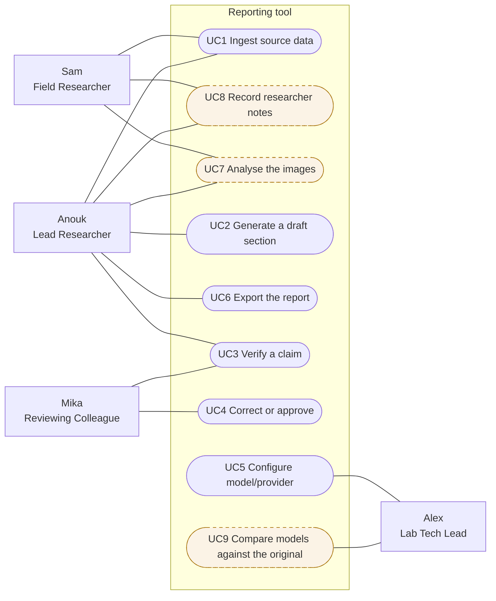
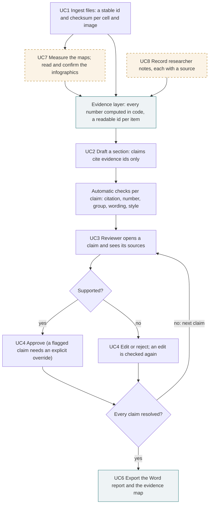
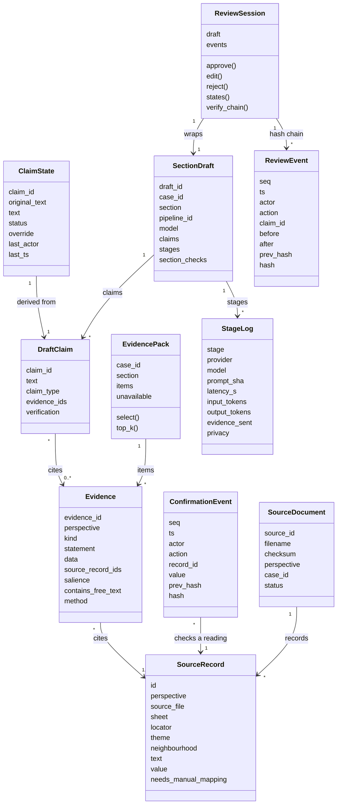

# Analysis Artifacts — AI-Supported Reporting System for InnoBeweegLab

Personas, scenarios, use cases, user stories, requirements, test cases and domain model, with the implementation status of 30 October 2026.

**Version 2 — 30 October 2026** · Alex Constantinescu · Master of Applied IT (Fontys ICT), InnoBeweegLab capstone project

Markdown edition of `InnoBeweegLab_AnalysisArtifacts_v2.pdf`, generated from the same LaTeX source (`InnoBeweegLab_AnalysisArtifacts_LaTeX_v2/`). The diagrams are drawn in Mermaid.

## Contents

- [Version history](#version-history)
- [1 Introduction](#1-introduction)
- [2 Personas and scenarios](#2-personas-and-scenarios)
- [3 Use cases](#3-use-cases)
- [4 User stories](#4-user-stories)
- [5 Requirements](#5-requirements)
- [6 Traceability and workflow](#6-traceability-and-workflow)
- [7 Test cases](#7-test-cases)
- [8 Domain model](#8-domain-model)
- [9 Review notes](#9-review-notes)
- [Sources](#sources)

## Version history

| Date | Version | Description |
|---|---|---|
| 2026-09-29 | 1 | *Innoweegbeg AI Reporting Tool — Requirements Engineering* (Word): context and scope, four personas, three scenarios, use cases UC1–UC6, user stories US1–US10, FR1–FR16, NFR1–NFR12, traceability summary, workflow, test cases TC1–TC14 and the domain model of the ingestion code. |
| 2026-10-09 | 1.1 | Review notes added: a consistency check against the research questions and the stakeholder survey. No corrections; three optional suggestions left to the author (kept unchanged in Section 9). |
| 2026-10-30 | 2 | This document, as PDF and as this Markdown file with the same content. The content of version 1.1 is kept word for word. Added: an implementation status for every use case, user story, requirement and test case, with the code or test that shows it; the domain model as now implemented; use cases UC7–UC9, user stories US11–US14, requirements FR17–FR21 and test cases TC15–TC22 for what was built since 29 September, each marked *(added 30 Oct)*; a use-case diagram; the workflow redrawn as built; review notes of 30 October. |

## 1 Introduction

### 1.1 Purpose of this document

This document collects the analysis artifacts of the AI-supported reporting tool for InnoBeweegLab: personas, scenarios, use cases, user stories, functional and non-functional requirements, their traceability, the main workflow, test cases and the domain model. Version 1 was the Requirements Engineering document of 29 September 2026, with review notes added on 9 October 2026. This version keeps that content word for word and adds three things.

1. **Implementation status.** Every use case, user story, requirement and test case now carries its status on 30 October 2026, with the code module or automated test that shows it.
2. **The domain model as built.** Section 8 describes the classes that the code implements today, not only the ingestion code and evaluation harness of September.
3. **What was built since.** Use cases UC7–UC9, user stories US11–US14, requirements FR17–FR21 and test cases TC15–TC22 cover image analysis, researcher notes and the comparison of models against the original report. They are derived from design decisions D11–D26 in `docs/design/reporting-tool-design.md`. Each is marked *(added 30 Oct)*; in tables their ID is marked *(new)*. They describe what the system does now and still need my confirmation as requirements, including their MoSCoW priority.

The review notes of 9 October are kept in Section 9. Their optional suggestions have not been applied.

### 1.2 Context and scope

This RE pass targets the AI-assisted reporting tool defined in Alex's Master's research (“From Research Data to Evidence-Based Recommendations: Designing and Evaluating an AI-Supported Reporting System for InnoBeweegLab”): a system that turns InnoBeweegLab's three-perspective Wijkscan/Buurtscan data (data, expert, bewoners) into a traceable, evidence-based draft report, with a mandatory human-in-the-loop validation step. It is grounded in the real Wijkscan Euterpepark Oss case as the reference input/output pair — see the Perspectieven Oss dataset inventory for the underlying file structure and the report's traceability map.

Two things this pass treats as settled inputs, not open questions: the six-theme taxonomy (Sporten, Actieve mobiliteit, Formeel spelen, Informeel spelen, Ontmoeten, Uitstraling) that already organizes both the source data and the target report, and the constraint envelope from the research plan — zero project budget, a standard 16GB-RAM/no-GPU office laptop, and mandatory human review before anything is finalized.

In scope: ingesting the three perspectives' raw files, generating a themed draft with per-claim source links, a review/verification interface, and export of an approved report. Out of scope for this pass: the underlying architecture choice itself (single-pass vs. multi-agent pipeline, research sub-question SQ3) and the exact model/provider selection (SQ4) — those remain open empirical questions for the Lab phase. These requirements describe what the system must guarantee regardless of which architecture answers them.

### 1.3 How to read the status

| Status | Meaning |
|---|---|
| **Built, tested** | Implemented, and an automated test passes. The test is named. |
| **Built** | Implemented and in use, without its own automated test, or checked by hand only. |
| **Built, no model run yet** | Implemented and tested with a stand-in model (Fake or Replay provider). Not yet run with a real local model, because the models are not installed yet. |
| **Partly** | Part of it is implemented; the gap is named. |
| **Not yet** | Not implemented, or not yet measured or evaluated. |

All tests use synthetic fixtures; no research data is in the repository. On 30 October 2026, 94 `unittest` tests and the 26 tests in the two standard-library runners (`tests/run_stdlib.py`, `tests/run_stdlib_evaluation.py`) pass. The pytest-only module `tests/test_evaluation.py` duplicates `run_stdlib_evaluation.py` and was not run here, because pytest was not installed.

## 2 Personas and scenarios

### 2.1 Personas

Four personas, unchanged since 29 September. Each persona stands for a role in InnoBeweegLab's reporting work.

| Persona | Role & context | Goals | Pain points today | Technical fluency |
|---|---|---|---|---|
| Anouk — Lead Researcher / Report Author | Writes the final Wijkscan report; synthesizes all three perspectives into themed narrative, conclusions, and recommendations (the role behind the Euterpepark report) | Produce a defensible draft fast without losing control of the interpretation and recommendations; justify any sentence to a client or reviewer | Manually re-reading dozens of survey rows, expert remark cells and map legends while writing narrative by hand; easy to lose track of which spreadsheet cell a sentence came from once several data rounds are merged | Comfortable with Excel/Word, not a developer |
| Sam — Field Researcher / Data Collector | Runs the resident surveys, coordinates the expert walkthroughs, and codes open-text answers into the six-theme taxonomy (the “Gecategoriseerde/Samengevoegde data” work) | Get raw survey and walkthrough data into a form the reporting tool can use, with minimal extra re-entry | Recoding the same open-text answers by hand every round; uncertainty about whether “categorized” vs. “merged” data will be picked up correctly | Comfortable with spreadsheets, no coding |
| Mika — Reviewing Colleague / Second Reader | A second InnoBeweegLab researcher who reads the draft before it goes to the client, checking that every notable claim is actually backed by evidence (the human-in-the-loop validation step) | Verify claims quickly without redoing the analysis from scratch; catch overclaims or misattributed quotes before they reach the client | Reviewers tend to run a full manual check regardless of how trustworthy an AI draft looks (the literature's “accountability paradox”) — so verification has to be genuinely fast, not just reassuring-looking | Similar to Anouk; not a developer |
| Alex — Lab Tech Lead / System Operator | Installs and configures the tool: which model runs locally, which (if any) hosted API drafts sections, and what data is allowed to leave the laptop | Keep the system running on zero budget and a standard laptop; switch providers/models without rebuilding the system; keep resident personal data off third-party clouds by default | No dedicated IT department or infrastructure budget at InnoBeweegLab; must self-serve all setup | Technically capable (this is Alex's own capstone build) |

The commissioning client (Gemeente Oss) reads the finished report but does not operate the tool directly; their need for a credible, well-organized report shapes the export requirements below rather than a use case of their own.

### 2.2 Scenarios

**Scenario A — Drafting the Euterpepark Wijkscan.** Sam finishes coding the resident survey responses into “Gecategoriseerde data” and uploads it alongside the three Expertwandeling spreadsheets and the QGIS map PNGs. Anouk opens the tool, picks the six-theme structure already used by the reference report, and asks it to draft the “Sporten” section. The tool pulls the relevant expert score-per-indicator rows, the matching remark cells, the resident Behoefte/Belemmering counts, and the Sport- en speelkaart map, and produces a paragraph in the same voice as the existing report — each sentence marked with the specific rows, cells, or image it came from. Anouk reads it in five minutes instead of the day it used to take to reassemble the same picture by hand.

**Scenario B — Catching an unsupported claim.** Mika reviews the “Uitstraling” section before it goes to the gemeente. One sentence claims residents specifically want “meer bankjes en horeca”; Mika clicks it and sees it's linked to only a single stakeholder's open-text remark, not a resident-survey count. She edits the sentence to reflect that it's one observation, not a majority view, and marks the claim as corrected. The system keeps her edit and the original AI draft in the audit trail. This is the exact failure mode the research is designed to catch — an AI draft that reads as more consensus-backed than its source actually supports.

**Scenario C — Running it on the office laptop.** Alex sets the tool up on InnoBeweegLab's shared laptop: no GPU, 16GB RAM. Tagging and extraction of raw survey rows into themes runs locally overnight in batch, free of charge; only the already-tagged, anonymized text is sent to a hosted model for the higher-stakes step of writing full sentences, through a provider-agnostic layer Alex can repoint at a different API without changing the rest of the system. No resident-identifying text ever leaves the laptop.

> **How the scenarios compare with the build (30 Oct)**
>
> - **Scenario A** is supported end to end with the template pipeline. The “five minutes” and the “same voice” are not measured yet, because no real model has run (US2, US10).
> - **Scenario B** is covered by two automatic checks. A claim that names residents but cites only stakeholder answers is flagged `attribution_mismatch`; majority wording on a single quote is flagged `overgeneralisation`. The edit keeps the original in the log (TC10).
> - **Scenario C** describes a hybrid set-up. In the current default, drafting also runs locally; a hosted EU model is configured but switched off, and would need InnoBeweegLab's permission (experiment E6). The provider-agnostic layer exists (NFR8).

## 3 Use cases

### 3.1 Overview and status

Nine use cases: UC1–UC6 from 29 September, and UC7–UC9 for what was built since. The use-case diagram shows which persona takes part in which use case.

| ID | Use case | Primary actor | Goal | Status (30 Oct) |
|---|---|---|---|---|
| UC1 | Ingest source data | Field Researcher, Lead Researcher | Bring the three perspectives' raw files into the system as usable input | **Built, tested** |
| UC2 | Generate a draft themed section | Lead Researcher | Produce narrative text for one of the six themes, grounded in source data | **Built, no model run yet** |
| UC3 | Verify a claim against its source | Lead Researcher, Reviewing Colleague | Confirm or reject that a sentence is backed by the source it cites | **Built** |
| UC4 | Correct or approve a claim | Reviewing Colleague | Edit, remove, or sign off a claim before the report is finalized | **Built, tested** |
| UC5 | Configure model/provider | Lab Tech Lead | Choose which model runs each pipeline step and where data may go | **Partly** (config files; per run, not per step) |
| UC6 | Export the approved report | Lead Researcher | Produce a final report document matching InnoBeweegLab's report structure | **Built, tested** |
| UC7 *(new)* | Analyse the images of a case | Lead Researcher, Field Researcher | Turn map images and infographics into citable, checked evidence | **Built, tested** (maps); vision reading: **Built, no model run yet** |
| UC8 *(new)* | Record researcher notes | Field Researcher, Lead Researcher | Make team knowledge that no source file holds citable, with a source | **Built, tested** |
| UC9 *(new)* | Compare models against the original report | Lab Tech Lead | Measure which model and pipeline produce the best report | **Partly** (approaches A, B; D not built) |

*Use-case diagram. Dashed amber use cases were added on 30 October (UC7–UC9). Lines connect each use case to the primary actors in the table above.*

### 3.2 UC1 — Ingest source data

**Preconditions:** raw files exist in supported formats (coded/raw survey xlsx, expert score-and-remarks xlsx, QGIS map images, PDFs).

**Main flow:**

1. Actor selects/uploads the source files for a given wijkscan.
2. System identifies file type and perspective (data/expert/bewoners).
3. System parses tabular files into rows tagged with theme, where a theme column already exists, or queues untagged rows for the tagging step.
4. System confirms what was ingested (counts per file/sheet) back to the actor.

**Alternate/exception flows:** an unsupported file format is rejected with a stated reason; a sheet whose structure matches no known template (neither “Score per indicator” nor “Gecategoriseerde data” shape, for example) is flagged for manual mapping rather than guessed at.

**Postconditions:** all source rows/images are stored and individually addressable for later citation.

> **Implementation, 30 October — Built, tested.** Oss (Wijkscan) and Buurtscan shapes: `ingestion/wijkscan.py`, `ingestion/buurtscan.py`, `ingestion/parsers/`. Every file gets a SHA-256 checksum, and byte-identical copies are skipped and reported (`ingestion/sources.py`). The command line and interface tab 1 show what was ingested per file. The original report PDF is registered as `excluded_reference_report`: it is used only for evaluation (UC9). Tests: `test_buurtscan_ingestion.py`, `tests/run_stdlib.py`.

### 3.3 UC2 — Generate a draft themed section

**Preconditions:** UC1 complete for at least one perspective touching the chosen theme.

**Main flow:**

1. Actor picks a theme (e.g. “Sporten”).
2. System retrieves the relevant rows/images across all ingested perspectives for that theme.
3. System drafts narrative text, attaching a source reference to each sentence/claim.
4. System marks any sentence it could not ground with a specific source.

**Alternate/exception flows:** no source data touches the chosen theme — the system says so instead of drafting from nothing; the local model is unavailable or a hosted call fails — the system reports the failure per section rather than silently omitting content.

**Postconditions:** a draft section exists, unpublished, every claim carrying zero or more source links.

> **Implementation, 30 October — Built, no model run yet.** Step 2 runs through an evidence layer (`evidence/builder.py`): numbers are computed in code and each claim cites evidence ids, which lead to the cells. Pipelines `template`, `naive` and `staged` (`drafting/pipelines.py`, prompt version v2). Since 29 September the same step also drafts Conclusies, Aanleiding and Methode (D18–D20). Tests: `test_staged_runs_one_call_per_perspective_plus_synthesis`, `test_empty_pack_does_not_draft_from_nothing`, `test_invalid_json_is_recorded_not_crashed`. Only the template has run on real data; the local models are not yet installed.

### 3.4 UC3 — Verify a claim against its source

**Preconditions:** a draft section exists (UC2).

**Main flow:**

1. Actor clicks a sentence/claim in the draft.
2. System shows the exact source excerpt(s) it was generated from — a spreadsheet cell, a row's average score, or a highlighted region of a map image.
3. Actor judges whether the claim is supported.

**Alternate/exception flows:** a claim has no linked source (already flagged in UC2) — the system shows “no source found” rather than an empty or misleading link.

**Postconditions:** none required (a read-only check); often followed by UC4.

> **Implementation, 30 October — Built.** Interface tab 3: per claim its check status, the reasons for any flag, and under “Bewijs en bron” each evidence item with its source rows (file, sheet, location, value, text). With no evidence it shows “Geen bron gevonden”. Map evidence shows the measurement; the overlay image that shows what was counted is in tab 1b, not inside the review screen. No automated interface test; the underlying flag is tested (`test_no_citation`).

### 3.5 UC4 — Correct or approve a claim

**Preconditions:** UC3 has been performed on the claim.

**Main flow:**

1. Actor edits the claim's wording, deletes it, or approves it as-is.
2. System records the action, the actor, and a timestamp.
3. Once every claim in a section is approved or edited, the section is marked reviewed.

**Alternate/exception flows:** actor approves a claim the system had flagged as weakly grounded — the system still records the override rather than silently accepting it, so the audit trail shows a human explicitly overrode the flag.

**Postconditions:** the claim's status (approved/edited/removed) and the responsible actor are permanently recorded.

> **Implementation, 30 October — Built, tested.** `review/session.py`: an append-only, hash-chained event log; the draft itself is never changed. Approving a flagged claim needs `confirm_override` and an extra tick box in the interface. An edited claim is checked again. Regenerating a section archives the earlier review. Tests: `test_flagged_claim_needs_override`, `test_edit_keeps_original_and_rechecks`, `test_tampering_is_detected`, `test_regenerate_archives_previous_review`.

### 3.6 UC5 — Configure model/provider

**Preconditions:** system installed on target hardware.

**Main flow:**

1. Actor sets which model handles local tagging/extraction and which, if any, hosted API handles section drafting.
2. Actor sets what data classes may leave the device (e.g. anonymized text only).
3. System validates the configuration is internally consistent (e.g. refuses a config that would send unredacted resident data to a non-EU hosted API).

**Alternate/exception flows:** the chosen local model doesn't fit in available RAM — the system warns before the actor commits the change.

**Postconditions:** subsequent UC1/UC2 runs use the new configuration.

> **Implementation, 30 October — Partly.** Models are configured in `config/models.toml`: local or hosted, memory estimate, data residency. `llm/registry.py` refuses a local model above 60% of 16 GB and a hosted provider without declared data residency, before a run. `llm/privacy.py` blocks resident free text to hosted providers unless an experiment sets a logged override, and pseudonymises first. Gaps: there is no settings screen, so configuration means editing a file (NFR10); the drafting model is chosen per run, not per pipeline step; and the only data class with its own rule is resident free text. Tests: `test_model_ram_validation`, `test_privacy_blocks_hosted_resident_text`, `test_privacy_override_is_logged`.

### 3.7 UC6 — Export the approved report

**Preconditions:** all sections in scope are marked reviewed (UC4).

**Main flow:**

1. Actor requests export.
2. System assembles the approved sections into the InnoBeweegLab report structure (Samenvatting → Methode → Resultaten per theme → Conclusies → Aanbevelingen → Bronnenlijst → Bijlagen).
3. System produces a document file.

**Alternate/exception flows:** a section is not yet fully reviewed — the system blocks export of the full report and states which section is holding it up.

**Postconditions:** a finished, human-approved report document exists outside the tool.

> **Implementation, 30 October — Built, tested.** `export/report.py` and `export/docx_report.py`: a Word report in the Wijkscan house layout (structure in `config/report_structure.toml`), charts drawn from survey evidence, maps in the theme text, and an appendix that traces each claim to evidence and cell; also `evidence_map.csv`. A preview for internal reading is marked CONCEPT. Recommendations are not generated; they stay with the researcher. Tests: `test_export_blocked_until_reviewed`, `test_template_run_renders_word_report`.

### 3.8 UC7 — Analyse the images of a case *(added 30 Oct)*

**Primary actor:** Lead Researcher (confirms readings); Field Researcher (supplies the maps).

**Preconditions:** UC1 has registered the case's map images and infographics; `config/images.toml` describes each image (kind, legend, themes, rules).

**Main flow:**

1. Actor starts the image analysis for a case.
2. System measures each map in code: the share of coloured buildings per legend class and neighbourhood, the share of homes inside a distance zone, or the number of markers per type.
3. System writes an overlay image per measurement and stores each measurement as a citable record.
4. If a vision model is configured, the system reads the printed values on the infographics several times, keeps the median and runs range checks.
5. Actor confirms, corrects or rejects each reading; the system logs each decision in a hash-chained log.

**Alternate/exception flows:** a zone map cannot be aligned with the reference map (border agreement below 0.8) — the measurement is refused, not guessed; two legend classes share a colour — they are merged and flagged; no vision model is configured — the infographics are listed as needing one, not skipped silently; the inspiration map shows proposals and is never measured as evidence.

**Postconditions:** measurements and readings are evidence items that drafting can cite; a claim that cites an unconfirmed reading is flagged as weak; rejected readings are dropped.

**Basis:** D11–D16, D26; Background Research v12, Sections 4.9 and 5.5.

> **Implementation, 30 October — Built, tested for maps; Built, no model run yet for readings.** `imaging/maps.py`, `imaging/pipeline.py`, `imaging/vision.py`, `imaging/confirm.py`; interface tab 1b. Tests: `test_imaging_and_oss.py`, `test_notes_zones_conclusions.py`.

### 3.9 UC8 — Record researcher notes *(added 30 Oct)*

**Primary actor:** Field Researcher, Lead Researcher.

**Preconditions:** a case exists (UC1).

**Main flow:**

1. Actor creates the notes template (an Excel file) for the case.
2. Actor records each note with its kind (walk observation, resident meeting, stakeholder talk, project context, literature), its theme and its source.
3. System ingests the notes; each note gets an `O-…` evidence id.
4. Drafting may cite notes; project context feeds the Aanleiding section and literature the Bronnenlijst.

**Alternate/exception flows:** re-ingesting the file replaces the notes instead of duplicating them; the template is never written over a filled file; notes from the resident meeting or a stakeholder talk carry the privacy flag and are attributed to the research team, never presented as the residents' view.

**Postconditions:** team knowledge that no source file holds can be cited with its source.

**Basis:** D17, D19; Background Research v12, Section 2.5 (in a sample of 54 statements from the reference report, 9 relied on such knowledge).

> **Implementation, 30 October — Built, tested.** `ingestion/parsers/notes_parser.py`, `note_evidence` in `evidence/builder.py`; interface tab 1. Tests: `test_template_never_overwrites_filled_notes`, `test_ingest_notes_replace_and_survive_reingest`, `test_meeting_note_is_not_the_residents_view`.

### 3.10 UC9 — Compare models against the original report *(added 30 Oct)*

**Primary actor:** Lab Tech Lead, as researcher (SQ3).

**Preconditions:** a case whose original human report is registered as reference and excluded from drafting; the local models are downloaded.

**Main flow:**

1. Actor selects the models (`[selection]` in `config/models.toml`) and a pipeline.
2. System checks, before the run, that the model server runs and that each model is downloaded.
3. System drafts every section per model with the same evidence, prompts and pipeline, verifies it and renders a Word report; runs are kept apart from the review sessions.
4. System compares each report with the original: chapters, coverage of the original's statements, the ceiling the evidence can support, numbers found back, maps and charts; optionally with a local LLM judge.
5. System writes one comparison table, one row per run.
6. Actor labels a sample of statements; the system computes Cohen's κ between the automatic and the human labels.
7. Actor may adopt one run as the starting point for the review (UC4).

**Alternate/exception flows:** a model cannot be reached — the run is refused before it starts; a hosted judge is refused because the original report is confidential; the original's text never reaches a prompt.

**Postconditions:** a comparison table per case; evaluation outputs that quote the original stay in the git-ignored workspace.

**Basis:** D22–D25; SQ3; implementation brief Sections 15–17.

> **Implementation, 30 October — Partly.** `reports/runs.py`, `reports/evaluate.py`, `reports/judge.py`, `reports/cli.py`; interface tab 5. Tests: `test_reports.py`. Not yet built: the checker pipeline (approach D), selection and seed options for full-report runs, averaging over repeats in the comparison table, and logging of the model's own memory use.

## 4 User stories

Fourteen user stories: US1–US10 from 29 September, word for word, and US11–US14 for what was built since. The status column says how far each acceptance criterion is met today.

| ID | Story | Acceptance criteria | Status (30 Oct) |
|---|---|---|---|
| US1 | As a **Field Researcher**, I want to upload the resident survey and expert walkthrough spreadsheets in the format I already produce them in, so that I don't have to re-enter or reformat data I've already collected. | System accepts the actual Wijkscan Euterpepark file shapes (Gecategoriseerde/Samengevoegde data, Score per indicator, Score/Opmerkingen) without manual reshaping; rejects only genuinely unrecognized formats, with a clear reason | **Built, tested**. Oss and Buurtscan shapes; unknown files flagged, not guessed (`test_unknown_file_is_not_guessed`). |
| US2 | As a **Lead Researcher**, I want to generate a first draft of a theme's Resultaten section from the ingested data, so that I don't have to manually reassemble the picture across three spreadsheets and a map every time. | A drafted section exists within a stated time budget on the standard laptop; every sentence has zero or more explicit source links | **Built, no model run yet**. Drafts with source links exist (template); the time on a 16 GB laptop is not measured yet. |
| US3 | As a **Lead Researcher**, I want to see, at a glance, which sentences in the draft have no supporting source, so that I know exactly where to focus my review, not re-check everything blindly. | Unsupported/weakly-grounded claims are visually distinguishable from grounded ones before I read a single word of the draft | **Built, tested**. Status per claim (`verification/checks.py`), counts and coloured badges in tab 3, coloured evidence ids in Word. |
| US4 | As a **Lead Researcher or Reviewer**, I want to click any sentence and see the exact source row, cell, or map region it came from, so that I can judge in seconds whether it's actually supported, the way MAXQDA's reference markers let a researcher jump to source text. | Clicking a claim opens the specific source excerpt (not just “the spreadsheet” or “the map”) in under 2 seconds | **Built**. Source rows per evidence item in tab 3; the 2-second target is not measured. |
| US5 | As a **Reviewer**, I want to edit or remove a claim I don't agree with, and have my change kept as the record, so that my professional judgment stays the final word, and I'm not just rubber-stamping the AI's output. | Edited/removed claims are saved with the reviewer's identity and timestamp; the original AI-drafted version remains visible in the history, not silently overwritten | **Built, tested** (`test_edit_keeps_original_and_rechecks`). |
| US6 | As a **Reviewer**, I want to be shown when I'm approving a claim the system itself had flagged as weak, so that I don't accidentally wave through something the tool already warned about. | An override of a flagged claim requires an explicit confirmation step, recorded separately from an ordinary approval | **Built, tested** (`test_flagged_claim_needs_override`). |
| US7 | As a **Lead Researcher**, I want to export the report only once every section is reviewed, so that nothing unreviewed reaches the gemeente under InnoBeweegLab's name. | Export is blocked, with a named reason, until every section's claims are approved or edited, not left pending | **Built, tested** (`test_export_blocked_until_reviewed`). |
| US8 | As a **Lab Tech Lead**, I want to choose which pipeline steps run on the local model versus a hosted API, so that I keep the system within a zero-budget, 16GB-RAM constraint without sacrificing report quality on the steps that matter most. | Configuration exposes a per-step choice (local/hosted) without requiring a code change; an invalid combination (e.g. a RAM-infeasible local model) is rejected before use, not after a failed run | **Partly**. Local or hosted per model, without a code change; RAM check before the run (`test_model_ram_validation`). Not per pipeline step. |
| US9 | As a **Lab Tech Lead**, I want to be sure resident-identifying data never reaches a hosted API unless I've explicitly allowed it, so that InnoBeweegLab stays GDPR-compliant with resident health/mobility data by default. | Default configuration routes any text still containing personal identifiers through the local model only; sending raw personal data to a hosted API requires an explicit, separately-logged override | **Built, tested** (`test_privacy_blocks_hosted_resident_text`, `test_privacy_override_is_logged`). |
| US10 | As a **Lead Researcher**, I want to see a draft section written in a voice and structure consistent with InnoBeweegLab's existing reports, so that the output is usable with light editing, not a rewrite. | A drafted theme section follows the same shape (finding → detail → cross-perspective synthesis) as the reference Euterpepark report for that theme | **Partly**. Prompt v2 follows the house order: data and maps, experts, residents, synthesis (D19). Not yet measured on model output. |
| US11 *(new)* | As a **Field Researcher**, I want to have each map measured per neighbourhood, with an overlay image I can check, so that the rule tests in the report rest on measured numbers, not on a model's reading of the picture. | Each map measurement is a citable record that states its method; an overlay shows what was counted; a zone map that does not fit the reference map is refused | **Built, tested** (`test_regions_and_shares`, `test_wrong_reference_is_refused_not_guessed`). |
| US12 *(new)* | As a **Lead Researcher**, I want to confirm, correct or reject every value a vision model read from an infographic, so that an unconfirmed reading never passes as a fact. | Readings start as unconfirmed; a claim that cites one is flagged weak; rejected readings are dropped; every decision is logged | **Built, tested** with a stand-in model (`test_unconfirmed_image_reading_is_weak`, `test_status_and_chain`); no vision model run yet. |
| US13 *(new)* | As a **Field or Lead Researcher**, I want to record what the team knows but no file holds, with its source, so that the tool can cite that knowledge instead of inventing it. | Five kinds of note in one Excel template; each note gets an id; notes from meetings are privacy-flagged and never presented as the residents' view | **Built, tested** (`test_note_evidence_perspectives_and_sections`, `test_meeting_note_is_not_the_residents_view`). |
| US14 *(new)* | As a **Lab Tech Lead**, I want to generate a full report per model and compare each with the original human report, so that the choice of model and approach rests on measurements. | Same evidence, prompts and pipeline per run; a missing model stops the run before it starts; one comparison table with coverage, ceiling, numbers and figures; agreement with human labels as Cohen's κ | **Partly** (`test_reports.py`). Approaches A and B work; D and averaging over repeats are not built. |

## 5 Requirements

### 5.1 Functional requirements

FR1–FR16 are word for word from 29 September. FR17–FR21 describe what was built since; their priority is still to be set.

| ID | Requirement | Priority | Traces to | Status (30 Oct) and evidence |
|---|---|---|---|---|
| FR1 | Accept, as source input, coded/raw qualitative survey spreadsheets, quantitative survey-tally spreadsheets, expert scoring-and-remarks spreadsheets, GIS-exported map images, and reference-report PDFs. | Must | UC1 | **Built, tested**. Reference PDF registered, excluded from drafting, used for evaluation. |
| FR2 | Detect which of the three perspectives (data/expert/bewoners) an ingested file belongs to, and confirm the detected mapping to the actor rather than applying it silently. | Must | UC1 | **Built, tested**. Detected per file and printed (`test_classify_known_kinds`). |
| FR3 | Flag any ingested sheet whose structure does not match a known template for manual mapping, rather than guessing at its meaning. | Must | UC1 | **Built, tested** (`test_unknown_file_is_not_guessed`, `test_unmapped_question_is_flagged`). |
| FR4 | Generate draft narrative text per theme, drawing on all ingested perspectives that touch that theme. | Must | UC2 | **Built, no model run yet** (`test_staged_runs_one_call_per_perspective_plus_synthesis`). |
| FR5 | Attach to every generated sentence that states a specific fact, count, or finding an explicit link to the source record(s) — row, cell, or image region — it was derived from. | Must | UC2, UC3 | **Built, tested**. Claim → evidence id → source record (`test_every_evidence_resolves_to_records`); appendix and `evidence_map.csv`. |
| FR6 | Visibly distinguish sentences with no linked source, or a low-confidence link, from fully-grounded sentences, before the reviewer opens any of them. | Must | UC2, UC3 | **Built, tested**. Grounded, weak or unsupported per claim (`test_no_citation`, `test_unsupported_number`). |
| FR7 | Let a reviewer open any claim and view the specific source excerpt(s) behind it, not merely the name of the source file. | Must | UC3 | **Built**. File, sheet, location and value per source record in tab 3. |
| FR8 | Let a reviewer edit, remove, or approve each claim individually. | Must | UC4 | **Built, tested** (`review/session.py`). |
| FR9 | Record, for every claim, its current status (AI-drafted / edited / removed / approved), the responsible person, and a timestamp, and retain the original AI-drafted version even after an edit. | Must | UC4 | **Built, tested** (`test_edit_keeps_original_and_rechecks`). |
| FR10 | Require an explicit, separately-recorded confirmation when a reviewer approves a claim the system had itself flagged as weakly grounded. | Should | UC4 | **Built, tested** (`test_flagged_claim_needs_override`). |
| FR11 | Block export of a report (or section) until every claim in it is approved or edited, and state which section is incomplete. | Must | UC6 | **Built, tested** (`test_export_blocked_until_reviewed`). |
| FR12 | Export an approved report as a document following the same section structure as InnoBeweegLab's existing Wijkscan reports (Samenvatting, Methode, Resultaten per theme, Conclusies, Aanbevelingen, Bronnenlijst, Bijlagen). | Must | UC6 | **Built, tested**. Word report in the house layout (`test_template_run_renders_word_report`). |
| FR13 | Let an operator configure, per pipeline step, whether a local model or a specified hosted API performs that step, without a code change. | Must | UC5 | **Partly**. Per run (drafting) and per image reading (vision) in `config/models.toml`; not per pipeline step. |
| FR14 | Validate a proposed model/provider configuration against the available hardware (e.g. RAM) before it is applied. | Should | UC5 | **Built, tested** (`test_model_ram_validation`). |
| FR15 | By default, route any text still containing personal identifiers through the local model only, and require an explicit, separately-logged override before sending such text to a hosted API. | Must | UC5 | **Built, tested** (`test_privacy_blocks_hosted_resident_text`, `test_privacy_override_is_logged`). |
| FR16 | Provide a mechanism to pseudonymize resident-identifying text before it is eligible to leave the local device. | Must | UC1, UC5 | **Built, tested**. Rule-based pseudonymiser, deliberately simple (`test_pseudonymise`). |
| FR17 *(new)* | Measure map images in code per neighbourhood (legend classes, distance-zone coverage, marker counts) and store each measurement as a citable record with an overlay image for checking. | To set | UC7 | **Built, tested** (`test_regions_and_shares`, `test_homes_inside_the_zone_per_neighbourhood`). |
| FR18 *(new)* | Read printed values from infographics with a local vision model only as unconfirmed evidence until a researcher confirms, corrects or rejects them, and log each decision tamper-evidently. | To set | UC7 | **Built, tested** with a stand-in model (`test_unconfirmed_image_reading_is_weak`, `test_status_and_chain`). |
| FR19 *(new)* | Accept researcher notes as a source type, each with its kind, theme and source, and flag notes from meetings for privacy. | To set | UC8 | **Built, tested** (`test_note_evidence_perspectives_and_sections`). |
| FR20 *(new)* | Generate a full report per selected model under identical evidence, prompts and pipeline, kept apart from the review sessions, and stop before the run when a model cannot be reached. | To set | UC9 | **Built, tested** (`test_model_run_is_kept_apart_from_review`, `test_unreachable_local_model_fails_before_the_run`); no real model run yet. |
| FR21 *(new)* | Compare a generated report with the original human report on structure, coverage, ceiling, numbers and figures, without the original's text reaching a prompt, and report agreement with human labels. | To set | UC9 | **Built, tested** (`test_alignment_ceiling_numbers_additions`, `test_calibrate`, `test_hosted_judge_refused`). |

### 5.2 Non-functional requirements

NFR1–NFR12 are word for word from 29 September; only the status column is new.

| ID | Category | Requirement | Rationale / source | Status (30 Oct) |
|---|---|---|---|---|
| NFR1 | Traceability | Every factual claim in a generated draft must resolve to a specific, independently checkable source record — not merely “grounded in general” — regardless of which underlying architecture (single-pass or multi-agent) produces it. | Literature review: the deciding factor across successful traceable-generation systems is an explicit verification/grounding step, not agent count | **Built, tested**. Claims carry only evidence ids; every pipeline uses the same checks. |
| NFR2 | Human control | The system shall never publish or finalize a report without an explicit human approval action on every included claim. | Core research-plan requirement: keep the researcher in control of interpretation and recommendations | **Built, tested**. Export gate; previews marked CONCEPT. |
| NFR3 | Usability of verification | The review interface's actual effect on reviewers catching unsupported claims must be usability-tested, not assumed from the presence of source links alone. | HCI literature: four independent studies (2018–2026) found visible provenance/trust cues change reliance without reliably changing verification accuracy — the “accountability paradox” | **Not yet**. Planned: review-screen workshop and the stakeholder evaluation of 7–18 December. |
| NFR4 | Ownership | The review workflow should preserve the reviewer's sense of authorship and control over the final wording, not just offer accept/reject on AI text. | CANote finding: AI-drafted-then-reviewed content improved quality but reduced reviewers' reported ownership | **Partly**. Reviewers can rewrite any claim and add their own; not yet evaluated with users. |
| NFR5 | Performance / hardware | Local pipeline steps (ingestion, tagging, extraction) must complete a typical batch (one wijkscan's worth of data) within a practical working session on a standard office laptop: 16GB RAM, CPU-only, no dedicated GPU. | Research plan hardware constraint (SQ4); realistic ceiling is a 7–9B model at Q4–Q6 quantization, ~10–20 tok/s | **Not yet** measured. Models fit the 60% memory check on paper; the 16 GB test is planned. |
| NFR6 | Cost | Total recurring operating cost shall stay within InnoBeweegLab's zero/near-zero project budget: a lean hosted-API integration path, if used, should stay in the EUR 5–50/month range, with free tiers acceptable during prototyping. | GenAI provider cost comparison business case | **Built**. Local models at no cost; the hosted provider is off by default and its prices are still to be filled in. |
| NFR7 | Data privacy / GDPR | Personal and special-category data (resident health/mobility information) must never leave the local device to a hosted API that lacks EU residency or a data-processing agreement, unless explicitly and separately authorized. | Cost-comparison doc's GDPR section; resident data likely includes special-category health/mobility information | **Built, tested**. Privacy guard; a hosted provider without declared data residency is refused. |
| NFR8 | Provider/architecture agnosticism | The system shall isolate model/provider choice behind an abstraction layer so the underlying architecture (single-pass vs. multi-agent) and model provider can be swapped and empirically compared without rebuilding the rest of the system. | Research plan SQ3/SQ4 require empirical comparison, not a fixed premise; also the Software-L4 “design a framework” competency target | **Built, tested**. One provider interface (`llm/base.py`); all pipelines share one input and output contract. |
| NFR9 | Interoperability | The system must ingest the real file shapes InnoBeweegLab's existing workflow already produces (Excel-based coded/scoring templates, QGIS-exported PNG maps, Word-exported PDFs) without requiring researchers to reformat their existing tools or process. | Confirmed directly against the Perspectieven Oss / Euterpepark file set | **Built, tested**. Oss and Buurtscan files as delivered. |
| NFR10 | Maintainability by non-specialists | Configuration and day-to-day operation must be usable by lab staff without dedicated IT or ML expertise. | InnoBeweegLab is a small, resource-constrained nonprofit-style lab with no dedicated IT department | **Partly**. Interface for daily work; configuration means editing TOML files; not yet tested with staff. |
| NFR11 | Auditability | A complete, tamper-evident history of every claim's drafted/edited/approved states and responsible actor must be retained for the life of the report. | Mission-driven-organizations literature: human oversight is framed as an ethical/accountability requirement toward a vulnerable population (65-plussers), not just an accuracy safeguard | **Built, tested**. Hash-chained logs (`test_tampering_is_detected`); earlier reviews archived. |
| NFR12 | Build-vs-buy justification | Any generic tool or framework the system builds on (e.g. an existing RAG framework) must be self-hostable within the zero-budget/16GB constraint and adaptable for qualitative+quantitative multi-source input — not a closed SaaS product. | Generic-tool-customization survey: no existing QDA/RAG product is adoptable wholesale under these constraints; an open framework adapted in-house is the realistic path | **Built**. Open-source stack (Python, Streamlit, Ollama); no SaaS dependency. |

## 6 Traceability and workflow

### 6.1 Requirements traceability matrix

Each use case traced to its personas, requirements, user stories and test cases. The persona, FR and NFR columns for UC1–UC6 are as on 29 September; the user-story and test-case columns follow from the “traces to” fields in Sections 4 and 7.

This table is itself a first exercise in the pattern the tool needs to support: every requirement here can be walked back to a specific line in the research plan, the dataset inventory, or the cited literature — the same claim-to-source discipline the system is meant to enforce.

| Use case | Personas | FR | NFR | US | TC |
|---|---|---|---|---|---|
| UC1 Ingest source data | Sam, Anouk | FR1, FR2, FR3, FR16 | NFR7, NFR9, NFR10 | US1 | TC1–TC4 |
| UC2 Generate a draft themed section | Anouk | FR4, FR5, FR6 | NFR1, NFR5, NFR6 | US2, US3, US10 | TC5, TC6, TC22 |
| UC3 Verify a claim against its source | Anouk, Mika | FR5, FR7 | NFR1, NFR3 | US3, US4 | TC5, TC7–TC9 |
| UC4 Correct or approve a claim | Mika | FR8, FR9, FR10 | NFR2, NFR4, NFR11 | US5, US6 | TC8, TC10, TC11 |
| UC5 Configure model/provider | Alex | FR13, FR14, FR15, FR16 | NFR6, NFR7, NFR8, NFR10, NFR12 | US8, US9 | TC12, TC13 |
| UC6 Export the approved report | Anouk | FR11, FR12 | NFR2, NFR11 | US7 | TC14 |
| UC7 Analyse the images *(added 30 Oct)* | Anouk, Sam | FR17, FR18 | NFR1, NFR9, NFR11 | US11, US12 | TC15–TC17, TC22 |
| UC8 Record researcher notes *(added 30 Oct)* | Sam, Anouk | FR19 | NFR1, NFR7 | US13 | TC18 |
| UC9 Compare models against the original *(added 30 Oct)* | Alex | FR20, FR21 | NFR5, NFR7, NFR8 | US14 | TC19–TC21 |

### 6.2 Workflow as built

The diagram below redraws the claim verification loop of 29 September (upload → tag → draft → verify → approve/edit → export) as it is now implemented. Two inputs were added before drafting: the image analysis (UC7) and the researcher notes (UC8). Between them and the draft sits the evidence layer, where every number is computed in code.

*The claim verification loop as built on 30 October. Dashed amber steps were added after 29 September; the two teal steps are the ends of the traceability chain (evidence in, report out).*

The loop between “Supported?” and “Edit or reject” stays open per claim until a human resolves it; a section only clears for export once every claim in it has been approved or corrected — this is the human-in-the-loop step the research design requires, drawn as the actual decision point rather than described in prose.

## 7 Test cases

On 29 September only UC1 and the evaluation harness existed, so TC9–TC14 were written as acceptance tests for use cases still to be built. All fourteen now have code behind them; the status column names the automated test. TC15–TC22 cover what was built since and map to tests that already exist. Steps and expected results of TC1–TC14 are word for word.

| ID | Test case | Traces to | Status (30 Oct) |
|---|---|---|---|
| TC1 | **Ingested file is routed to the correct perspective** *Steps:* (1) upload a resident-survey xlsx, an expert score/remarks xlsx, and a QGIS map PNG together; (2) inspect the resulting SourceRecords. *Expected:* each record's perspective is correctly “bewoners”, “expert”, or “data”, and the mapping is confirmed back to the actor rather than applied silently. | UC1, FR1, FR2 | **Built, tested** `test_map_filename_theme_lookup_unambiguous_vs_flagged`, `test_classify_known_kinds` |
| TC2 | **An unrecognized sheet shape is flagged, not guessed** *Steps:* (1) ingest a spreadsheet matching neither the “Score per indicator” nor “Gecategoriseerde data” template. *Expected:* the resulting record(s) have needs_manual_mapping=True and theme=None; nothing is auto-assigned. | UC1, FR3 | **Built, tested** `test_unknown_file_is_not_guessed`, `test_unmapped_question_is_flagged`, `test_survey_sheet_maps_known_column_flags_unknown` |
| TC3 | **Re-ingesting the same file updates rather than duplicates** *Steps:* (1) ingest a file and note the record count; (2) re-ingest the identical file (same perspective/source_file/sheet/locator, so the same derived id). *Expected:* SourceStore.add replaces the existing record (last one wins); the store's total count is unchanged, not doubled. | UC1 | **Built, tested** for duplicate files (skipped by checksum, `test_end_to_end_folder`) and notes (`test_ingest_notes_replace_and_survive_reingest`). `SourceStore.add` itself still has no test of its own. |
| TC4 | **Store round-trips through JSON without loss** *Steps:* (1) ingest several records across perspectives/themes; (2) save() the store, then load() it back. *Expected:* the reloaded store has the same record count, and every field (including theme, needs_manual_mapping) matches the original. | UC1 | **Built, tested** `test_store_round_trips_through_json` |
| TC5 | **A fully-grounded claim scores faithfulness = 1.0** *Steps:* (1) build a Claim whose cited_ids are a non-empty subset of its matched GoldClaim.supporting_ids; (2) score it with faithfulness(). *Expected:* score is 1.0 — the claim counts as fully supported. | UC2, UC3, FR5, FR6, NFR1 | **Built, tested** `run_stdlib_evaluation.py` (synthetic gold set) |
| TC6 | **An uncited claim counts as fabrication, not silent acceptance** *Steps:* (1) build a Claim matched to a GoldClaim with cited_ids=(); (2) score the draft with fabrication_rate() and faithfulness(). *Expected:* fabrication_rate counts the claim; faithfulness gives it no credit — “no citation” is never treated as implicitly grounded. | UC2, FR5, FR6, NFR1 | **Built, tested** `test_fabrication_counts_uncited_claims_not_misgrounding`; in drafts also `test_no_citation` |
| TC7 | **A real-but-wrong citation is told apart from fabrication** *Steps:* (1) build a Claim that cites a real SourceRecord id outside its matched GoldClaim.supporting_ids; (2) score with misgrounding_rate() and fabrication_rate(). *Expected:* misgrounding_rate counts it, fabrication_rate does not — the harness distinguishes “cites nothing” from “cites something real but wrong” (the RegLab failure mode), which matters because UC3's reviewer needs to know which failure they're looking at. | UC3, NFR1 | **Built, tested** `test_misgrounding_counts_real_but_wrong_citation_not_fabrication` |
| TC8 | **A planted citation error is caught before a human sees it** *Steps:* (1) build a Claim with injected_error=True whose citations do not fully support its matched GoldClaim; (2) score with injected_error_catch_rate(). *Expected:* the claim is counted as caught. This is the harness's current floor for what UC3's verification step must beat, and it is directly relevant to NFR3's “accountability paradox” finding that visible provenance alone doesn't guarantee a human catches an error. | UC3, UC4, NFR1, NFR3 | **Built, tested** `test_injected_error_caught_when_misgrounded`. The interface-level catch rate still needs its NFR3 usability test (**Not yet**). |
| TC9 | **A claim with no linked source shows “no source found,” not a blank or misleading link** *Steps:* (1) open a drafted claim whose cited_ids is empty; (2) click it in the review interface. *Expected:* the interface explicitly states no source was found, rather than showing nothing or pointing at an unrelated file. | UC3, FR7, US4 | **Built**. Tab 3 shows “Geen bron gevonden”; checked by hand, no automated interface test. |
| TC10 | **Editing a claim keeps the original AI draft visible in history** *Steps:* (1) reviewer edits a claim's wording; (2) reopen the claim's history. *Expected:* both the original AI-drafted text and the edited version are visible, with the editor's identity and a timestamp; the original is never overwritten. | UC4, FR9, US5, NFR11 | **Built, tested** `test_edit_keeps_original_and_rechecks` |
| TC11 | **Overriding a flagged weak claim needs its own explicit confirmation** *Steps:* (1) reviewer attempts to approve a claim the system flagged as weakly grounded (e.g. from TC6/TC7); (2) observe the approval flow. *Expected:* a separate, explicit confirmation step is required beyond a normal approval click, and the override is recorded distinctly from an ordinary approval. | UC4, FR10, US6, NFR4 | **Built, tested** `test_flagged_claim_needs_override`; the interface adds a tick box. |
| TC12 | **A RAM-infeasible model configuration is warned before being applied** *Steps:* (1) operator selects a local model configuration whose footprint exceeds the target laptop's 16GB RAM; (2) attempt to save the configuration. *Expected:* the system warns before the change is committed, not after a failed run; the previous working configuration stays active until confirmed. | UC5, FR14, US8, NFR5 | **Built, tested** `test_model_ram_validation`: refused before the run. The configuration is a file, so there is no pending configuration to keep. |
| TC13 | **Personal-identifier text does not reach a hosted API by default** *Steps:* (1) ingest resident survey text still containing personal identifiers; (2) run the drafting step with a hosted-API provider configured, without setting any override. *Expected:* identifying text is routed through the local model only; sending it to the hosted API requires an explicit, separately-logged override action, not a default-on setting. | UC5, FR15, FR16, US9, NFR7 | **Built, tested** `test_privacy_blocks_hosted_resident_text`, `test_privacy_override_is_logged`, `test_pseudonymise` |
| TC14 | **Export is blocked while any section has unapproved claims** *Steps:* (1) approve/edit every claim in five of six theme sections, leave one claim pending in the sixth; (2) request export of the full report. *Expected:* export is blocked, and the system names the specific section still holding it up — not a generic failure. | UC6, FR11, US7, NFR2, NFR11 | **Built, tested** `test_export_blocked_until_reviewed` |
| TC15 *(new)* | **A map is measured per neighbourhood** *Steps:* (1) measure a synthetic map with a legend and border lines; (2) give it two legend classes in the same colour. *Expected:* a share per legend class and region; markers counted per region; identical legend colours merged and flagged. | UC7, FR17, US11 | **Built, tested** `test_regions_and_shares`, `test_count_objects_per_region`, `test_identical_legend_colours_are_flagged` |
| TC16 *(new)* | **Zone coverage is measured, and a misfit is refused** *Steps:* (1) align a zone map with a map on the same base map; (2) repeat with a wrong reference map. *Expected:* homes inside the zone per neighbourhood; with the wrong reference, the measurement is refused, not guessed. | UC7, FR17, US11 | **Built, tested** `test_registration_on_shared_base_map`, `test_homes_inside_the_zone_per_neighbourhood`, `test_wrong_reference_is_refused_not_guessed` |
| TC17 *(new)* | **An unconfirmed reading flags the claim** *Steps:* (1) read an infographic several times with a stand-in vision model; (2) cite an unconfirmed reading in a claim; (3) confirm it. *Expected:* the median of the readings is kept; the claim is weak until confirmation; the confirmation log verifies as a chain. | UC7, FR18, US12 | **Built, tested** `test_self_ensemble_median_and_agreement`, `test_unconfirmed_image_reading_is_weak`, `test_status_and_chain` |
| TC18 *(new)* | **A meeting note is not presented as the residents' view** *Steps:* (1) ingest a note from the resident meeting; (2) cite it in a claim that says “bewoners”. *Expected:* the note carries the privacy flag and is attributed to the research team; a filled notes file is never overwritten by the template. | UC8, FR19, US13 | **Built, tested** `test_meeting_note_is_not_the_residents_view`, `test_template_never_overwrites_filled_notes` |
| TC19 *(new)* | **An unreachable model stops the run before it starts** *Steps:* (1) start a full-report run with a model that is not downloaded. *Expected:* the run is refused with a clear message before any section is drafted. | UC9, FR20, US14 | **Built, tested** `test_unreachable_local_model_fails_before_the_run` |
| TC20 *(new)* | **The confidential original stays local** *Steps:* (1) ask for a comparison with a hosted judge model. *Expected:* the hosted judge is refused; only a local judge or word overlap is used. | UC9, FR21, NFR7 | **Built, tested** `test_hosted_judge_refused` |
| TC21 *(new)* | **The comparison measure is sane** *Steps:* (1) compare a rendered report with itself; (2) compare two drafts of one case. *Expected:* the self-comparison scores above 90% on generated text; the ceiling does not depend on the draft. | UC9, FR21, US14 | **Built, tested** `test_report_against_itself`, `test_deterministic_and_ceiling_independent_of_the_draft` |
| TC22 *(new)* | **A rule is called met or not met only from a measurement** *Steps:* (1) draft a claim that a RIVM rule is (not) met, citing only the rule; (2) cite a map measurement that tests the rule. *Expected:* the first claim is flagged `norm_not_measured`; the second passes. | UC2, UC7, FR17, NFR1 | **Built, tested** `test_compliance_needs_a_measurement_that_tests_the_rule`, `test_coverage_evidence_tests_the_rule` |

## 8 Domain model

On 29 September the domain model covered the ingestion code (`SourceRecord`, `SourceStore`) and the evaluation harness (`Claim`, `GoldClaim`, `Draft`, `RunResult`); the drafting side was specified but not built. The class diagram below shows the classes as implemented on 30 October. The chain that makes a claim traceable: a claim holds only evidence ids, each evidence item holds the ids of its source records, and each source record holds file, sheet and locator.

*Domain model as implemented on 30 October 2026, read from the code (`ingestion/`, `evidence/`, `drafting/models.py`, `review/session.py`, `imaging/confirm.py`). ConfirmationEvent was added after 29 September for image readings. Only the main fields are shown.*

### 8.1 Entities

| Entity | Code | Purpose / notes |
|---|---|---|
| SourceDocument | `ingestion/sources.py` | One per input file, with a SHA-256 checksum. Byte-identical copies are skipped and reported; an experiment run records exactly which file versions it used. The original report is kept as `excluded_reference_report`, for evaluation only. |
| SourceRecord | `ingestion/models.py` | The one addressable unit everything downstream cites (UC1). The locator (e.g. “row 6”, “B6:C6”, “image”) makes a citation resolvable without re-parsing the source file; the id is derived deterministically, so re-ingesting the same cell yields the same id. Image measurements and readings are records too. |
| SourceStore | `ingestion/store.py` | The repository of records: `by_theme()`, `by_perspective()`, `flagged()` (the manual-mapping queue of FR3), JSON save and load. |
| Evidence, EvidencePack | `evidence/models.py`, `evidence/builder.py` | A pre-computed fact with a readable id, a Dutch statement, every number in machine form and the ids of its source records. A pack holds all evidence for one case and section. This is the only thing a drafting model sees. |
| DraftClaim, SectionDraft, StageLog | `drafting/models.py` | The output contract every pipeline must produce: claims that hold evidence ids only, never facts of their own; one stage log per model call with prompt fingerprint, latency, tokens and privacy note. |
| ReviewSession, ReviewEvent, ClaimState | `review/session.py` | An append-only, hash-chained log per section. The draft is never changed; the current state of each claim is derived from the draft and the events. `verify_chain()` detects edits to the log (NFR11). |
| ConfirmationEvent  *(added 30 Oct)* | `imaging/confirm.py` | A researcher's confirm, correct or reject decision on an image reading, hash-chained like the review log. |
| Run records  *(added 30 Oct)* | `experiments/runner.py`, `reports/runs.py` | JSON per run: configuration, code version, data checksums, prompt fingerprints, drafts, check metrics, time and tokens. A full-report run also keeps its Word report and its evaluation against the original. |
| Claim, GoldClaim, Draft, RunResult | `evaluation/` | The first evaluation harness of 29 September, still used for TC5–TC8. It scores citation sets against a synthetic gold set and is not yet connected to real drafts. |

### 8.2 Relationships

| From | Relationship | To |
|---|---|---|
| SourceRecord | belongs to exactly one | perspective (data / expert / bewoners / reference) |
| SourceRecord | tagged with zero or one | theme (from THEMES), optionally a subtheme |
| SourceRecord | flagged via needs_manual_mapping when | no known template shape matches (FR3) |
| Evidence | cites one or more, by id (source_record_ids) | SourceRecord |
| DraftClaim | cites zero or more, by id (evidence_ids) | Evidence — zero, or an unknown id, makes the claim unsupported |
| ReviewSession | wraps exactly one | SectionDraft, and logs ReviewEvents in a hash chain |
| ConfirmationEvent | confirms, corrects or rejects | one image-reading SourceRecord |

## 9 Review notes

### 9.1 Consistency check of 9 October 2026 (unchanged)

A read-through of the personas, use cases, user stories, and NFRs above against the current main research question, the DOT sub-questions (Lab/SQ3, Lab/SQ4), and the Background Research Report's Section 3.8 stakeholder survey — all finalized 7 October 2026, after this document's 29 September 2026 dateline. Nothing below is a correction: everything already written here still holds. These are optional strengthening opportunities, left for the author to decide on rather than applied here.

1. **Dateline gap, no contradiction found.** This document predates the Lab/SQ3–SQ4 sub-questions and the 7 October stakeholder survey; everything in it was checked against both and nothing here is factually inconsistent with either.
2. **NFR1 (Traceability) and NFR2 (Human control) currently cite literature only.** Optional: add the survey's quantified backing alongside it — traceability scored 4.8/5 and human review/approval scored a unanimous 5.0/5 on importance (Section 3.8) — the same way the Background Research Report folds this survey into its own traceability discussion.
3. **US2's acceptance criterion says “within a stated time budget,”** which was a placeholder when written. The survey now gives an actual stakeholder-validated number: 3 of 5 respondents want a 25–50% reduction in analysis/reporting time, 2 of 5 want 10–25%, nobody asked for more than 50%. Optional: replace the placeholder in US2 (and possibly NFR5) with that figure.
4. **NFR8 and the Context & scope section's SQ3/SQ4 references** were checked against the current Lab/SQ3, Lab/SQ4 wording in the research plan and literature review — they already match; no change needed.
5. No inconsistencies were found in the personas, scenarios, UC1–UC6, or the remaining NFRs.

The stakeholder survey is Section 4.8 in version 12 of the Background Research Report.

### 9.2 Status review of 30 October 2026

1. **UC2–UC6 are now built.** TC9–TC14 were written as acceptance tests for use cases still to be built; all six now have code, and five have an automated test (TC9 is checked by hand).
2. **Built but not yet measured.** No real model has run yet, so NFR5 (a batch within a working session on 16 GB), US2 (time budget), US4 (under 2 seconds) and US10 (house voice) are open. NFR3 (usability of verification) and NFR10 (use by lab staff) need the review-screen workshop and the December evaluation.
3. **FR13 and US8 ask for a per-step choice of model.** The code chooses the model per run and per image reading. Either the requirement is narrowed to per-run, or per-stage routing is built. *Decision needed.*
4. **Scenario C describes a hybrid set-up** with a hosted model for drafting. The current default drafts locally; a hosted EU model is configured but off and needs InnoBeweegLab's permission (experiment E6).
5. **The added items need confirmation.** UC7–UC9, US11–US14, FR17–FR21 and TC15–TC22 describe what the code does now. Their MoSCoW priority is still to be set.
6. **The suggestions of 9 October are still open** (points 2 and 3 above).

## Sources

- *Innoweegbeg AI Reporting Tool — Requirements Engineering*, 29 September 2026, with review notes of 9 October 2026 (Word). All unmarked content of this document.
- Design decisions D1–D26: `docs/design/reporting-tool-design.md` in the repository. Basis of the items marked *(added 30 Oct)*.
- Repository code and tests on 30 October 2026: `src/` and `tests/`. Basis of every status.
- Implementation brief, Sections 12 and 15–17.
- Background Research Report, version 12 (October 2026), Sections 2.5, 4.8, 4.9 and 5.5.
