# All diagrams on one page

Every diagram of the set, in order. Click an image to open it full size; the SVG link gives a
sharp version you can zoom (best for the large class diagrams 31–39). What each diagram is for,
the notation and how to update them: [README](README.md).

## Contents

**Research**

- [01 · Research design](#d01) · flowchart
- [02 · Experiment design](#d02) · flowchart
- [03 · Validation framework](#d03) · flowchart

**The tool as a system (C4)**

- [10 · System context](#d10) · C4 level 1
- [11 · Containers](#d11) · C4 level 2
- [12 · Components](#d12) · C4 level 3
- [13 · Deployment](#d13) · deployment

**Architectures under study (SQ3)**

- [20 · Overview](#d20) · flowchart
- [21 · Evidence layer (H1)](#d21) · flowchart
- [22 · E2 staged pipeline](#d22) · UML sequence
- [23 · E4 checker](#d23) · flowchart
- [24 · E3 selection](#d24) · flowchart
- [25 · E6 and C0](#d25) · flowchart

**The code (UML)**

- [30 · Packages](#d30) · package
- [31 · ingestion](#d31) · class (generated)
- [32 · evidence, drafting](#d32) · class (generated)
- [33 · llm](#d33) · class (generated)
- [34 · verification, review](#d34) · class (generated)
- [35 · imaging](#d35) · class (generated)
- [36 · export](#d36) · class (generated)
- [37 · reports, experiments](#d37) · class (generated)
- [38 · app, ui](#d38) · class (generated)
- [39 · evaluation](#d39) · class (generated)
- [40 · Ingest and evidence](#d40) · sequence
- [41 · Experiment run](#d41) · sequence
- [42 · Review and export](#d42) · sequence
- [43 · Images](#d43) · sequence
- [44 · State machines](#d44) · state machine
- [45 · Verifier](#d45) · activity
- [46 · Traceability](#d46) · object

---

## Research

### 01 · Research design

*flowchart* · main question, the DOT phases (Library, Field, Design, Lab SQ3/SQ4, Workshop, Showroom), what each delivers, status

[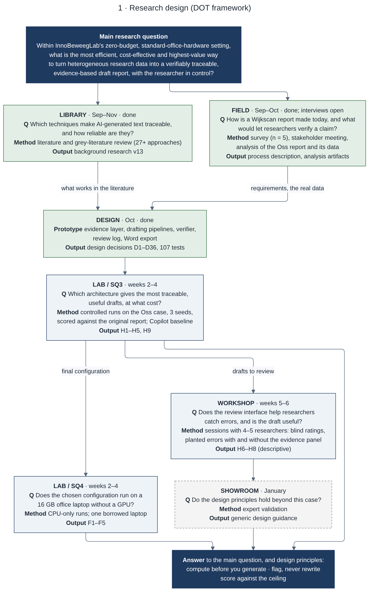](out/01-research-design.png)

Full size: [PNG](out/01-research-design.png) · [SVG](out/01-research-design.svg) · Mermaid source: [01-research-design.mmd](src/01-research-design.mmd) · [↑ contents](#contents)

### 02 · Experiment design

*flowchart* · week-1 pilot, week-2 build and check V1, scorer check, freeze on 13 Nov, stages 1–3 (architecture, selection, models), feasibility and references, user sessions, results on 11 Dec

[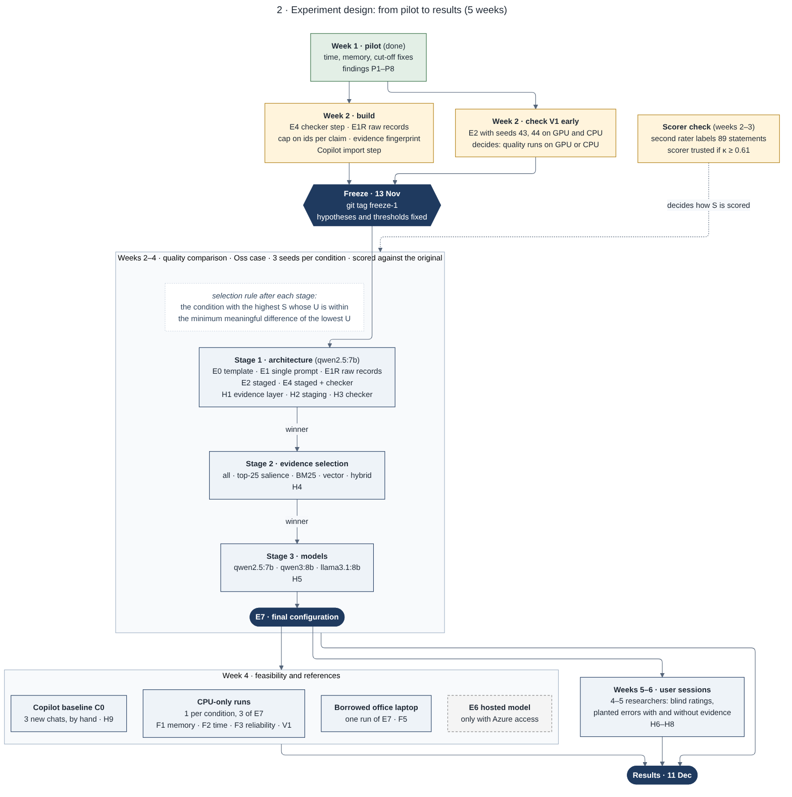](out/02-experiment-design.png)

Full size: [PNG](out/02-experiment-design.png) · [SVG](out/02-experiment-design.svg) · Mermaid source: [02-experiment-design.mmd](src/02-experiment-design.mmd) · [↑ contents](#contents)

### 03 · Validation framework

*flowchart* · inputs, measures computed in code (U, S, time, memory), validity checks (scorer κ, V1), statistics, outcome per comparison, conclusions per sub-question

[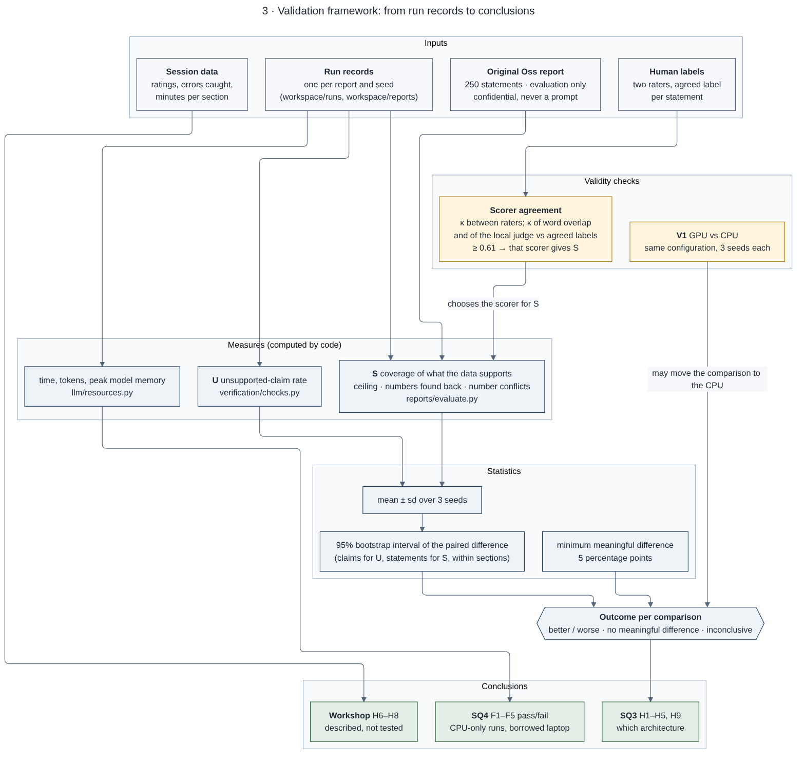](out/03-validation-framework.png)

Full size: [PNG](out/03-validation-framework.png) · [SVG](out/03-validation-framework.svg) · Mermaid source: [03-validation-framework.mmd](src/03-validation-framework.mmd) · [↑ contents](#contents)

---

## The tool as a system (C4)

### 10 · System context

*C4 level 1* · four researcher roles, the tool, the data files, Ollama, the optional hosted API, the original report (scoring only), the municipality, Copilot (baseline C0)

[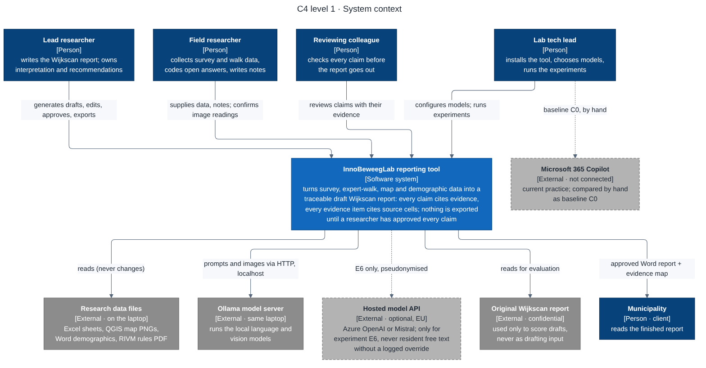](out/10-c4-context.png)

Full size: [PNG](out/10-c4-context.png) · [SVG](out/10-c4-context.svg) · Mermaid source: [10-c4-context.mmd](src/10-c4-context.mmd) · [↑ contents](#contents)

### 11 · Containers

*C4 level 2* · Streamlit UI, command-line tools, core library, workspace files, config and prompts; Ollama, hosted API, LibreOffice, original report

[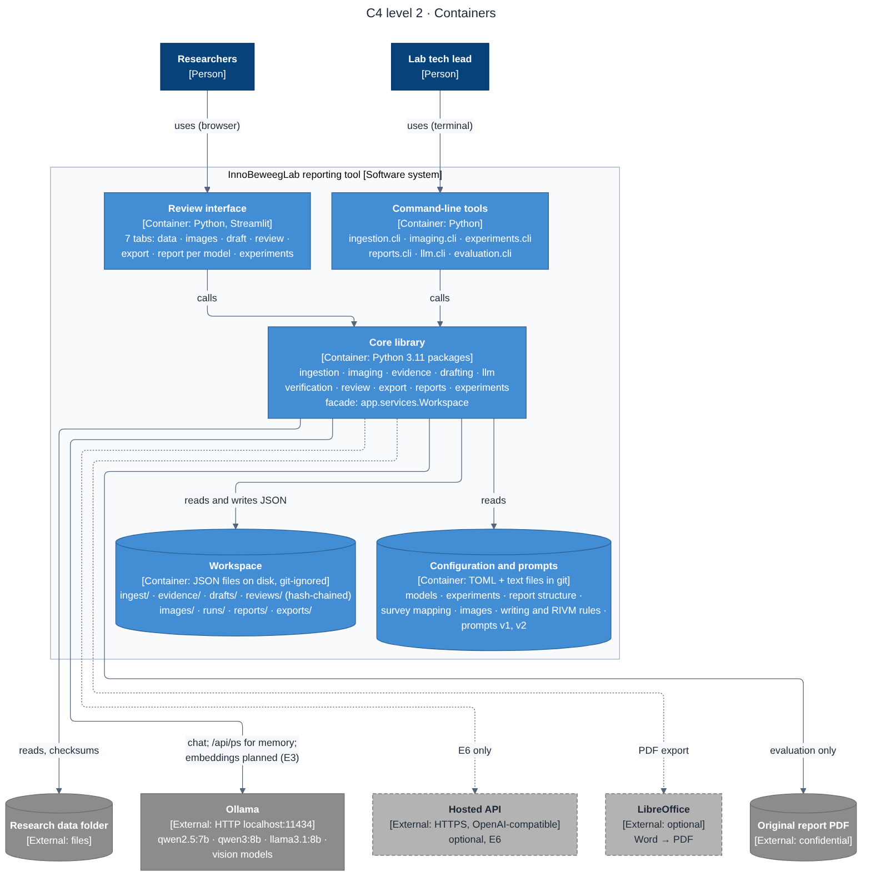](out/11-c4-containers.png)

Full size: [PNG](out/11-c4-containers.png) · [SVG](out/11-c4-containers.svg) · Mermaid source: [11-c4-containers.mmd](src/11-c4-containers.mmd) · [↑ contents](#contents)

### 12 · Components

*C4 level 3* · the components of the core library (one per package) and their main dependencies

[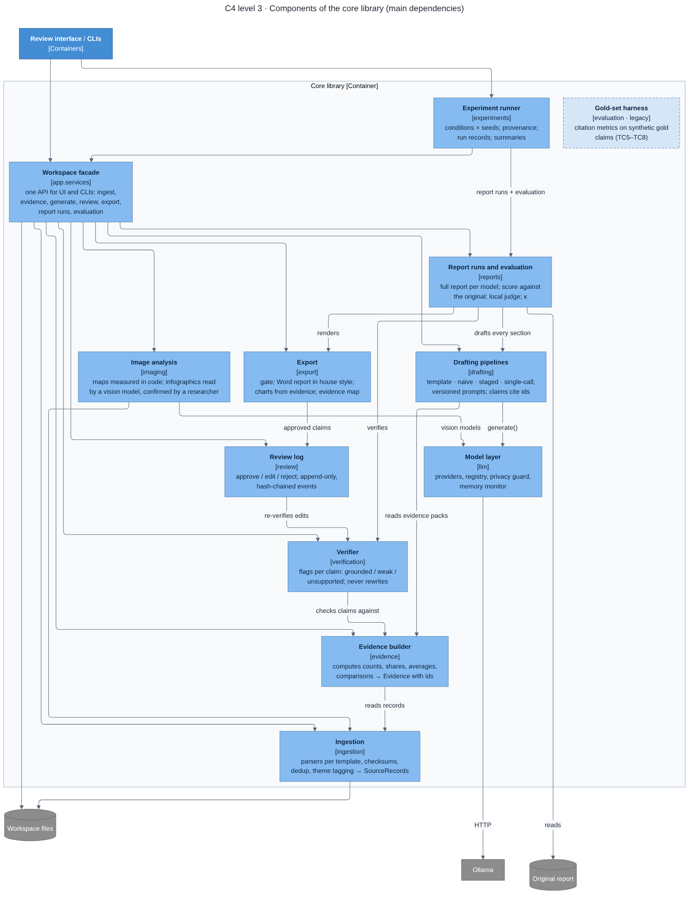](out/12-c4-components.png)

Full size: [PNG](out/12-c4-components.png) · [SVG](out/12-c4-components.svg) · Mermaid source: [12-c4-components.mmd](src/12-c4-components.mmd) · [↑ contents](#contents)

### 13 · Deployment

*deployment* · the development laptop, the target office laptop (F5), GitHub, the Microsoft 365 tenant (Copilot, Azure OpenAI in the EU)

[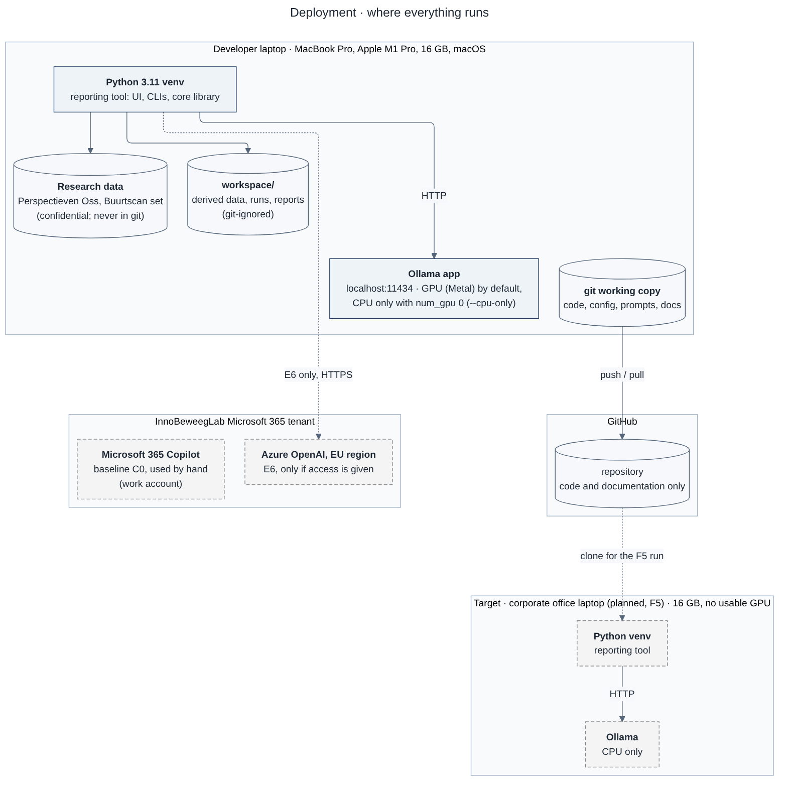](out/13-deployment.png)

Full size: [PNG](out/13-deployment.png) · [SVG](out/13-deployment.svg) · Mermaid source: [13-deployment.mmd](src/13-deployment.mmd) · [↑ contents](#contents)

---

## Architectures under study (SQ3)

### 20 · Overview

*flowchart* · every condition (E0–E7, C0) side by side, built or to build, all scored the same way

[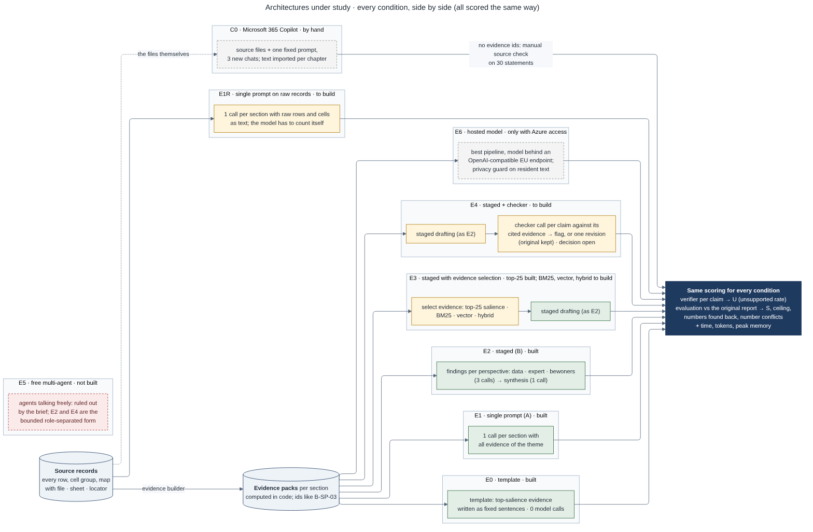](out/20-architectures-overview.png)

Full size: [PNG](out/20-architectures-overview.png) · [SVG](out/20-architectures-overview.svg) · Mermaid source: [20-architectures-overview.mmd](src/20-architectures-overview.mmd) · [↑ contents](#contents)

### 21 · Evidence layer (H1)

*flowchart* · E1 (evidence computed in code) against E1R (raw records), same model and prompt shape

[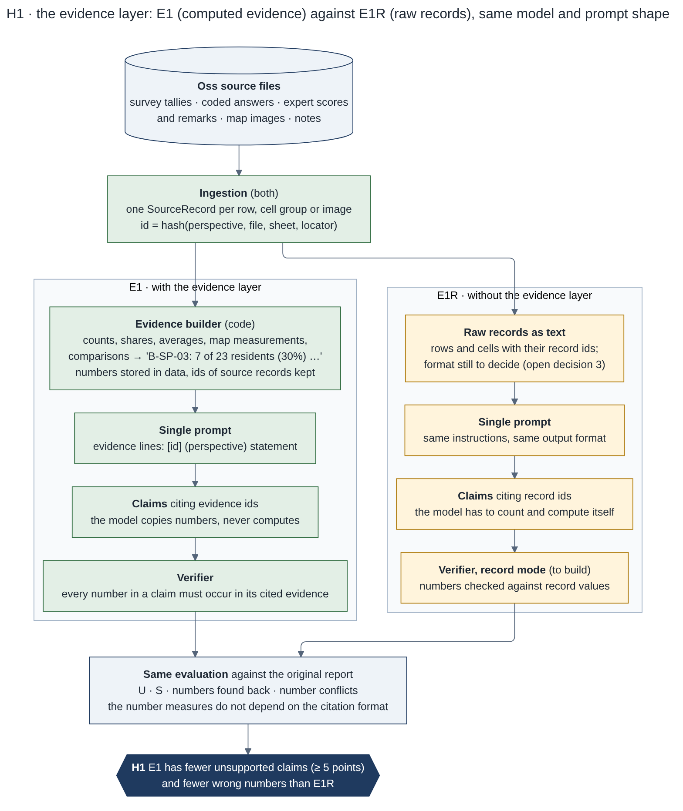](out/21-h1-evidence-layer.png)

Full size: [PNG](out/21-h1-evidence-layer.png) · [SVG](out/21-h1-evidence-layer.svg) · Mermaid source: [21-h1-evidence-layer.mmd](src/21-h1-evidence-layer.mmd) · [↑ contents](#contents)

### 22 · E2 staged pipeline

*UML sequence* · per-perspective findings, synthesis, privacy check, verifier

[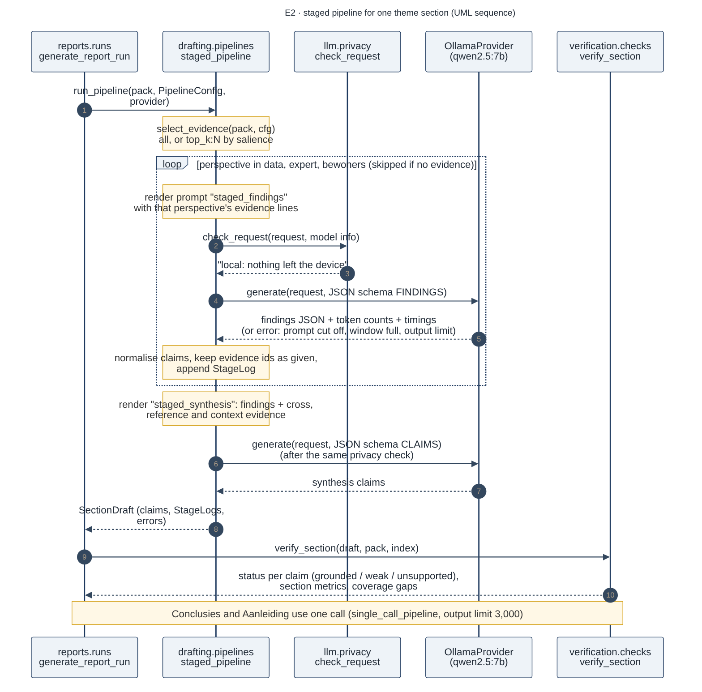](out/22-e2-staged-sequence.png)

Full size: [PNG](out/22-e2-staged-sequence.png) · [SVG](out/22-e2-staged-sequence.svg) · Mermaid source: [22-e2-staged-sequence.mmd](src/22-e2-staged-sequence.mmd) · [↑ contents](#contents)

### 23 · E4 checker

*flowchart* · the staged pipeline with a checker step (design decision still open)

[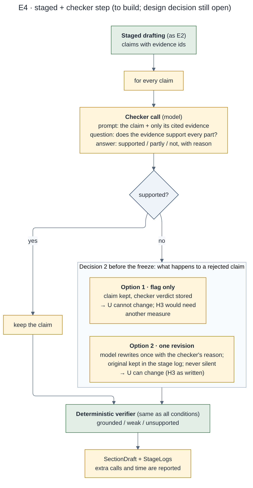](out/23-e4-checker.png)

Full size: [PNG](out/23-e4-checker.png) · [SVG](out/23-e4-checker.svg) · Mermaid source: [23-e4-checker.mmd](src/23-e4-checker.mmd) · [↑ contents](#contents)

### 24 · E3 selection

*flowchart* · all, top-25, BM25, vector, hybrid selection before drafting

[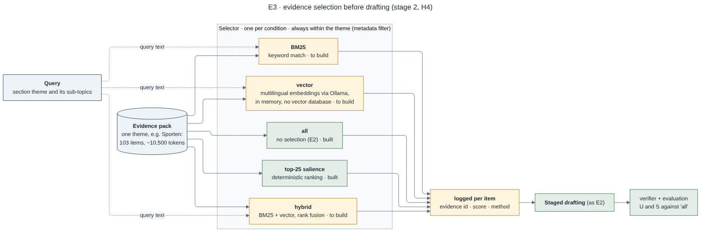](out/24-e3-selection.png)

Full size: [PNG](out/24-e3-selection.png) · [SVG](out/24-e3-selection.svg) · Mermaid source: [24-e3-selection.mmd](src/24-e3-selection.mmd) · [↑ contents](#contents)

### 25 · E6 and C0

*flowchart* · the hosted model run and the Microsoft 365 Copilot baseline

[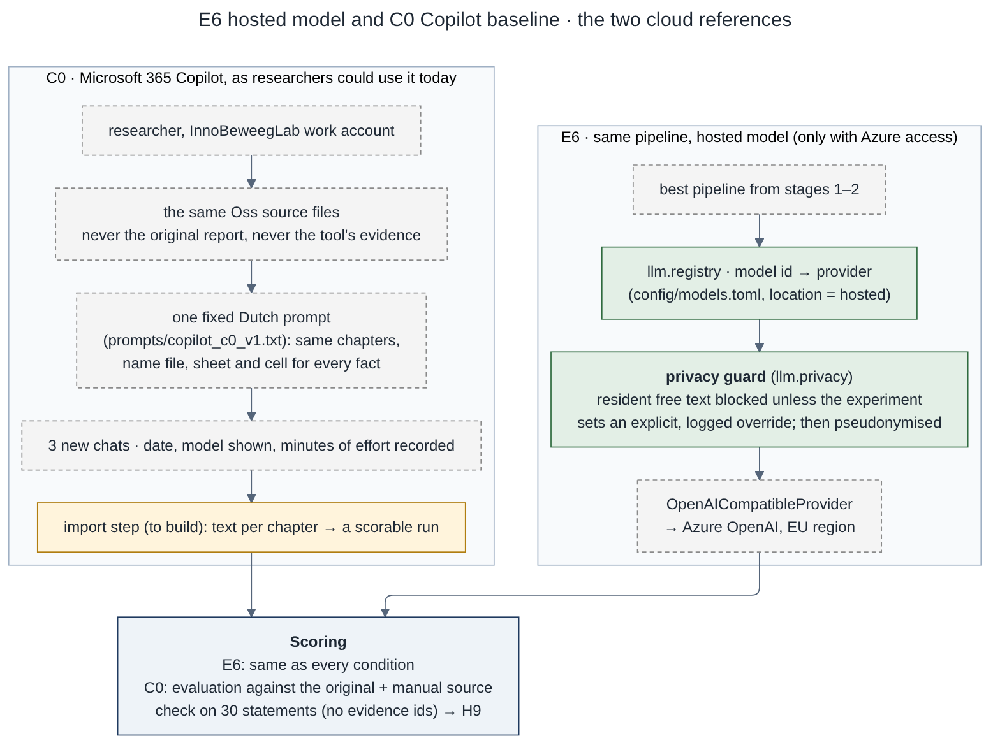](out/25-e6-c0.png)

Full size: [PNG](out/25-e6-c0.png) · [SVG](out/25-e6-c0.svg) · Mermaid source: [25-e6-c0.mmd](src/25-e6-c0.mmd) · [↑ contents](#contents)

---

## The code (UML)

### 30 · Packages

*package* · all 13 packages, entry points, imports (module-level and lazy)

[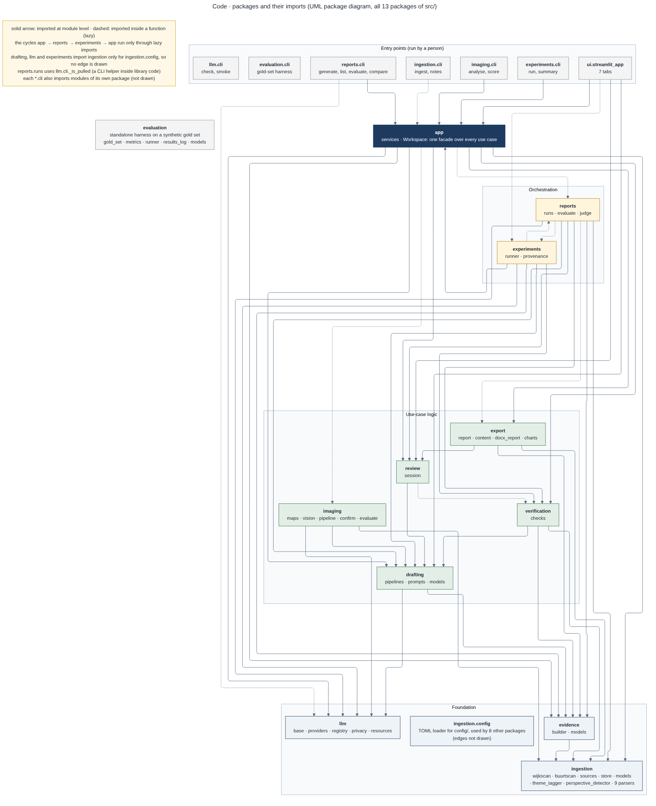](out/30-code-packages.png)

Full size: [PNG](out/30-code-packages.png) · [SVG](out/30-code-packages.svg) · Mermaid source: [30-code-packages.mmd](src/30-code-packages.mmd) · [↑ contents](#contents)

### 31 · ingestion

*class (generated)* · folders and files → SourceDocument, SourceRecord, SourceStore; all nine parsers

Full size: [PNG](out/31-code-ingestion.png) · [SVG](out/31-code-ingestion.svg) · Mermaid source: [31-code-ingestion.mmd](src/31-code-ingestion.mmd) · [↑ contents](#contents)

### 32 · evidence, drafting

*class (generated)* · Evidence, EvidencePack, the builder; PipelineConfig, the pipelines, DraftClaim, SectionDraft, StageLog

[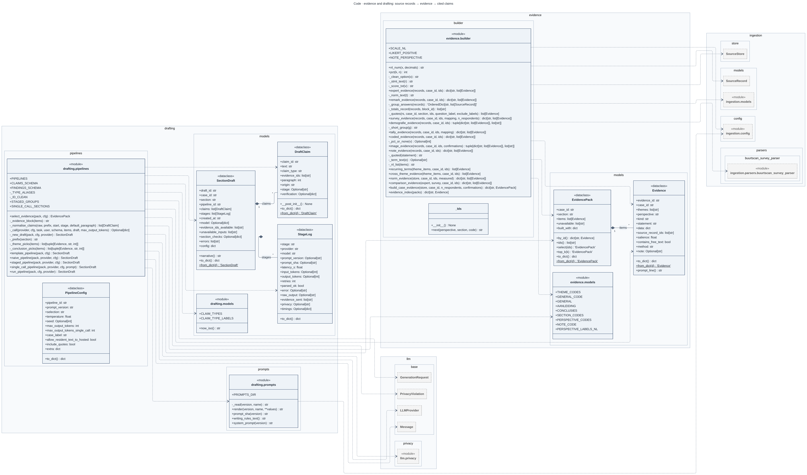](out/32-code-evidence-drafting.png)

Full size: [PNG](out/32-code-evidence-drafting.png) · [SVG](out/32-code-evidence-drafting.svg) · Mermaid source: [32-code-evidence-drafting.mmd](src/32-code-evidence-drafting.mmd) · [↑ contents](#contents)

### 33 · llm

*class (generated)* · LLMProvider, the providers, registry, privacy guard, MemoryMonitor

[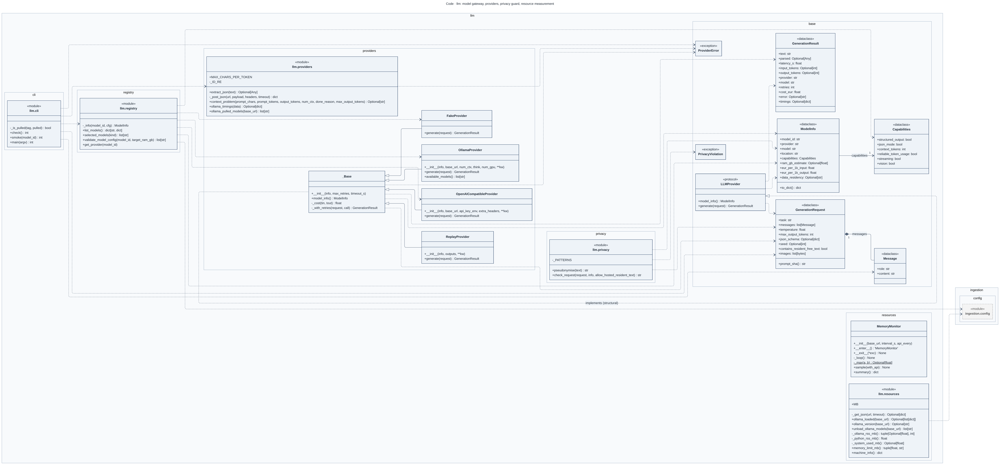](out/33-code-llm.png)

Full size: [PNG](out/33-code-llm.png) · [SVG](out/33-code-llm.svg) · Mermaid source: [33-code-llm.mmd](src/33-code-llm.mmd) · [↑ contents](#contents)

### 34 · verification, review

*class (generated)* · Flag and the checks; ReviewSession, ReviewEvent, ClaimState

[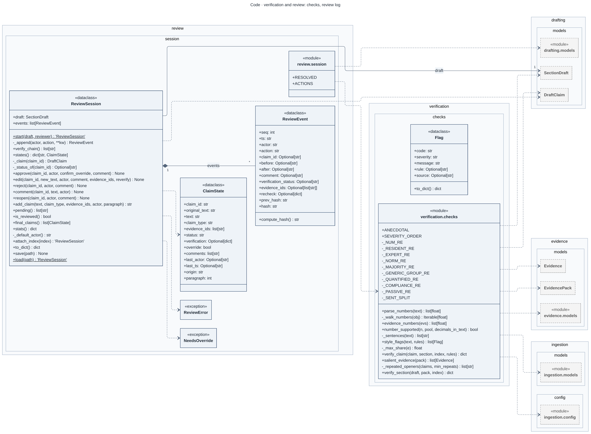](out/34-code-verification-review.png)

Full size: [PNG](out/34-code-verification-review.png) · [SVG](out/34-code-verification-review.svg) · Mermaid source: [34-code-verification-review.mmd](src/34-code-verification-review.mmd) · [↑ contents](#contents)

### 35 · imaging

*class (generated)* · map measurement, vision reading, confirmation log, scoring

[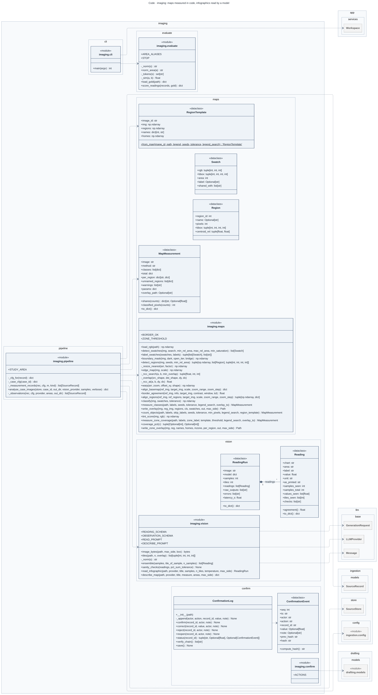](out/35-code-imaging.png)

Full size: [PNG](out/35-code-imaging.png) · [SVG](out/35-code-imaging.svg) · Mermaid source: [35-code-imaging.mmd](src/35-code-imaging.mmd) · [↑ contents](#contents)

### 36 · export

*class (generated)* · Markdown and evidence map, ReportContent, WijkscanRenderer, charts

[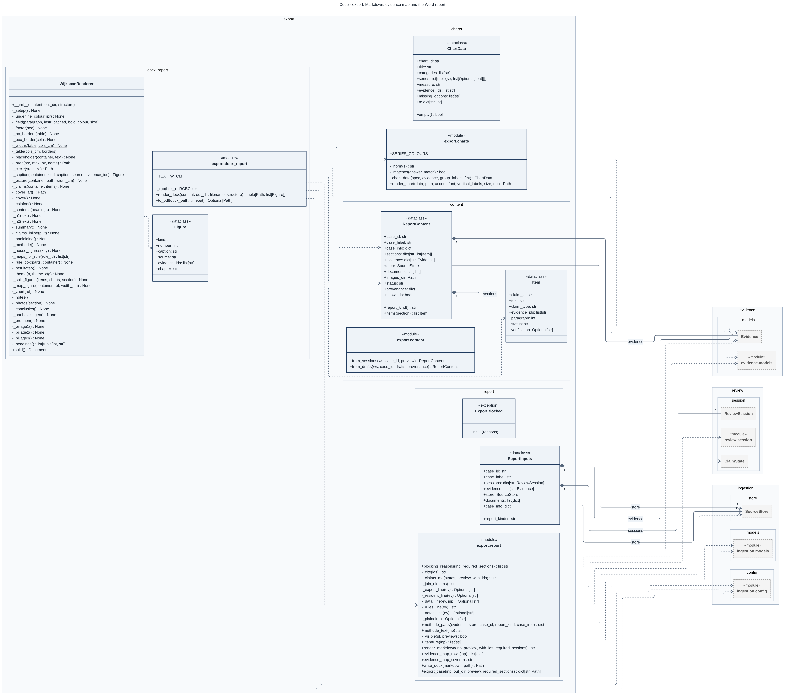](out/36-code-export.png)

Full size: [PNG](out/36-code-export.png) · [SVG](out/36-code-export.svg) · Mermaid source: [36-code-export.mmd](src/36-code-export.mmd) · [↑ contents](#contents)

### 37 · reports, experiments

*class (generated)* · report runs, evaluation against the original, judge, experiment runner, provenance

Full size: [PNG](out/37-code-reports-experiments.png) · [SVG](out/37-code-reports-experiments.svg) · Mermaid source: [37-code-reports-experiments.mmd](src/37-code-reports-experiments.mmd) · [↑ contents](#contents)

### 38 · app, ui

*class (generated)* · Workspace (the facade every entry point uses) and the Streamlit app

Full size: [PNG](out/38-code-app-ui.png) · [SVG](out/38-code-app-ui.svg) · Mermaid source: [38-code-app-ui.mmd](src/38-code-app-ui.mmd) · [↑ contents](#contents)

### 39 · evaluation

*class (generated)* · the standalone gold-set harness (synthetic data)

[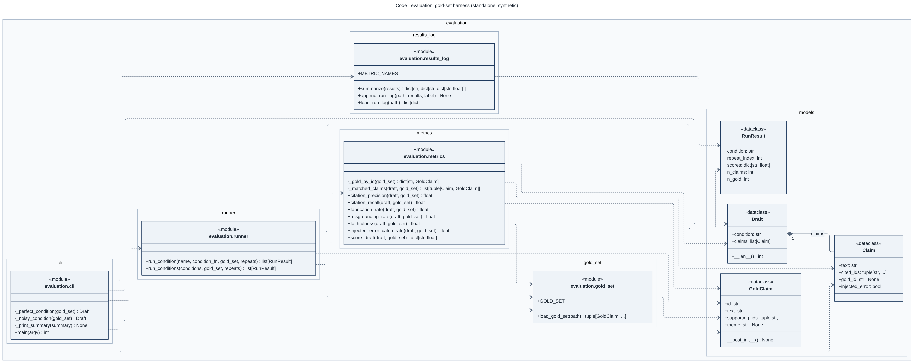](out/39-code-evaluation.png)

Full size: [PNG](out/39-code-evaluation.png) · [SVG](out/39-code-evaluation.svg) · Mermaid source: [39-code-evaluation.mmd](src/39-code-evaluation.mmd) · [↑ contents](#contents)

### 40 · Ingest and evidence

*sequence* · UC1: a Wijkscan folder to source records, then to evidence packs

[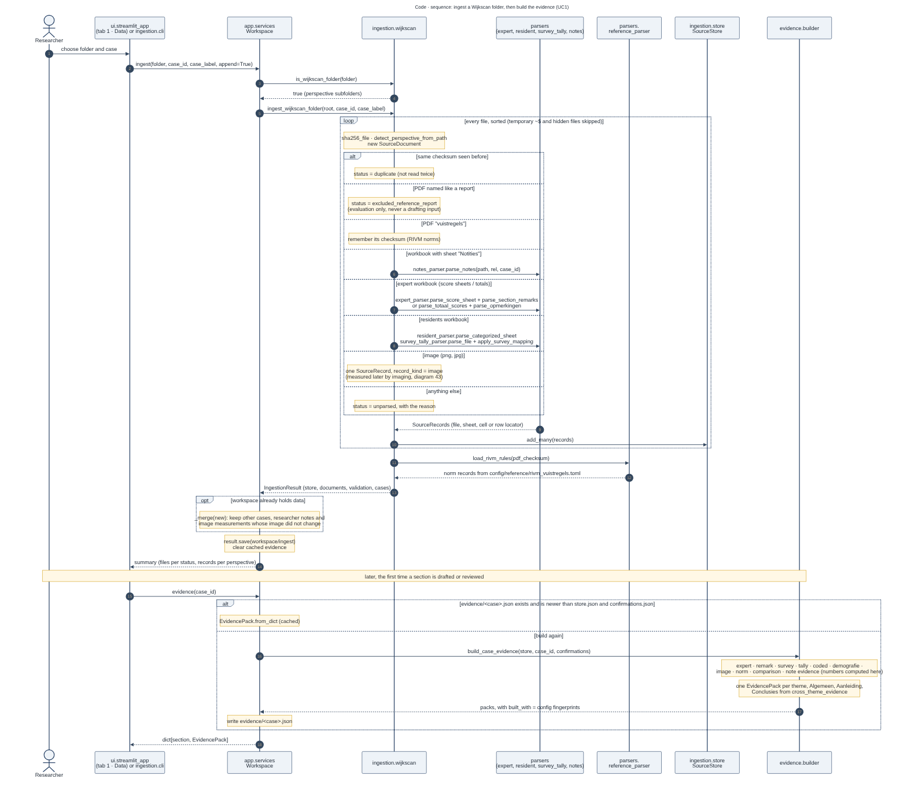](out/40-seq-ingest-evidence.png)

Full size: [PNG](out/40-seq-ingest-evidence.png) · [SVG](out/40-seq-ingest-evidence.svg) · Mermaid source: [40-seq-ingest-evidence.mmd](src/40-seq-ingest-evidence.mmd) · [↑ contents](#contents)

### 41 · Experiment run

*sequence* · UC9, SQ3/SQ4: one experiment, per seed a full report with memory measurement, then evaluation

[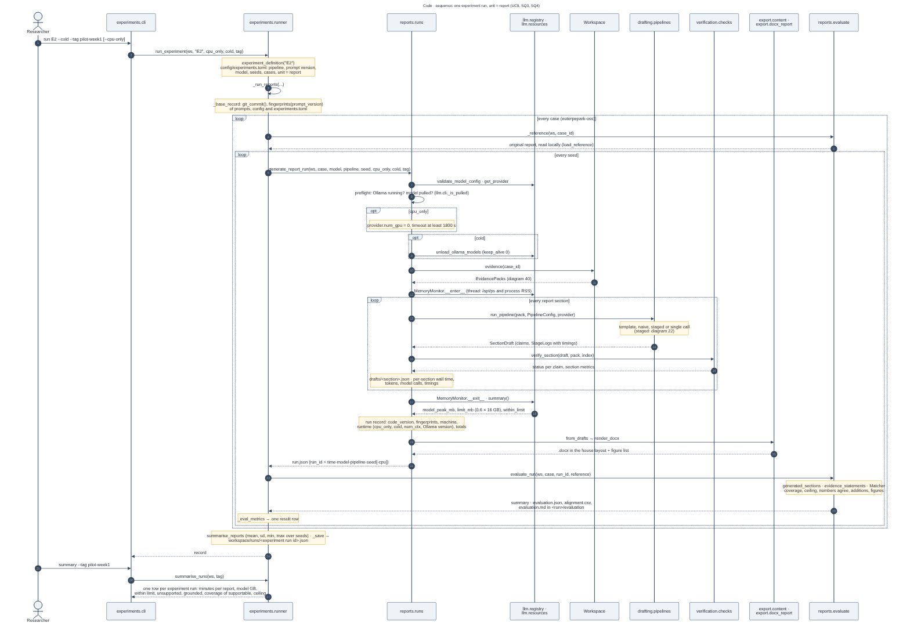](out/41-seq-experiment-run.png)

Full size: [PNG](out/41-seq-experiment-run.png) · [SVG](out/41-seq-experiment-run.svg) · Mermaid source: [41-seq-experiment-run.mmd](src/41-seq-experiment-run.mmd) · [↑ contents](#contents)

### 42 · Review and export

*sequence* · UC2–UC4, UC6: draft, verify, review (with override), export gate, Word report

[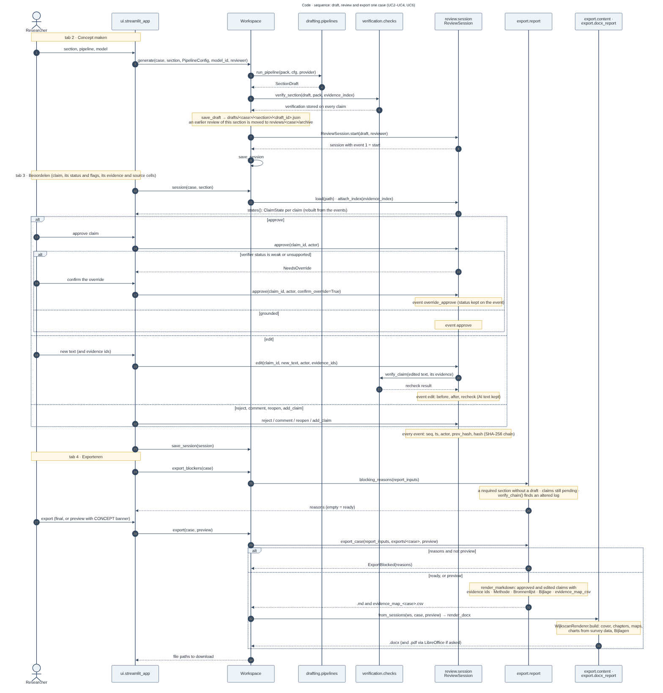](out/42-seq-review-export.png)

Full size: [PNG](out/42-seq-review-export.png) · [SVG](out/42-seq-review-export.svg) · Mermaid source: [42-seq-review-export.mmd](src/42-seq-review-export.mmd) · [↑ contents](#contents)

### 43 · Images

*sequence* · UC7: maps measured in code, infographics read by a model, readings confirmed

[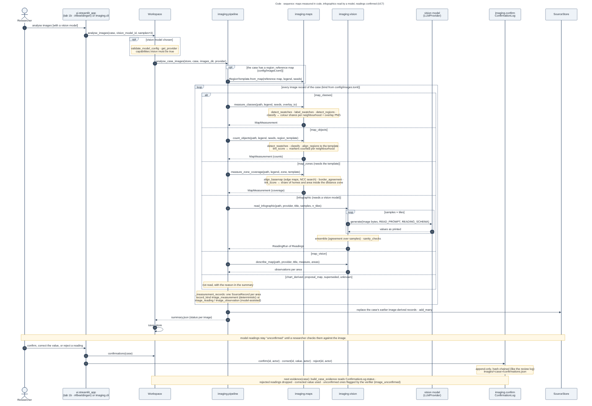](out/43-seq-images.png)

Full size: [PNG](out/43-seq-images.png) · [SVG](out/43-seq-images.svg) · Mermaid source: [43-seq-images.mmd](src/43-seq-images.mmd) · [↑ contents](#contents)

### 44 · State machines

*state machine* · a claim under review; an image reading under confirmation

[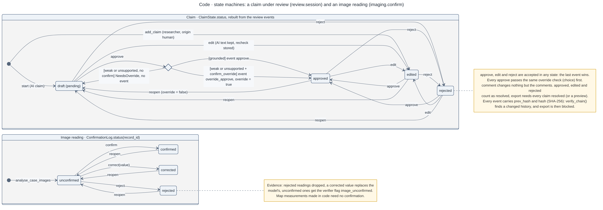](out/44-state-claim-and-reading.png)

Full size: [PNG](out/44-state-claim-and-reading.png) · [SVG](out/44-state-claim-and-reading.svg) · Mermaid source: [44-state-claim-and-reading.mmd](src/44-state-claim-and-reading.mmd) · [↑ contents](#contents)

### 45 · Verifier

*activity* · every check of verify_claim, how the status follows, the section checks

[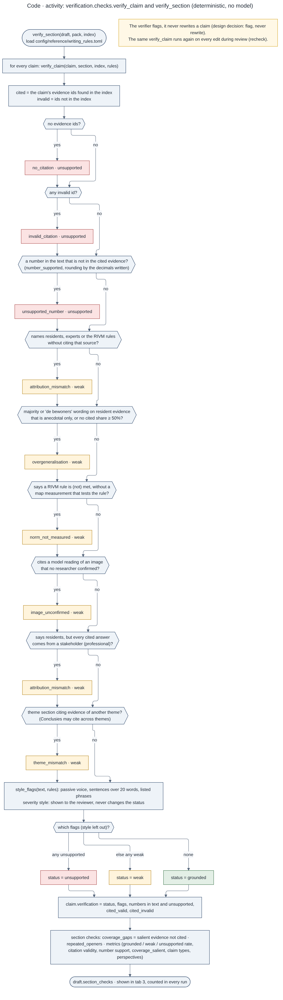](out/45-activity-verifier.png)

Full size: [PNG](out/45-activity-verifier.png) · [SVG](out/45-activity-verifier.svg) · Mermaid source: [45-activity-verifier.mmd](src/45-activity-verifier.mmd) · [↑ contents](#contents)

### 46 · Traceability

*object* · one approved claim traced through draft, evidence and source record to a cell

[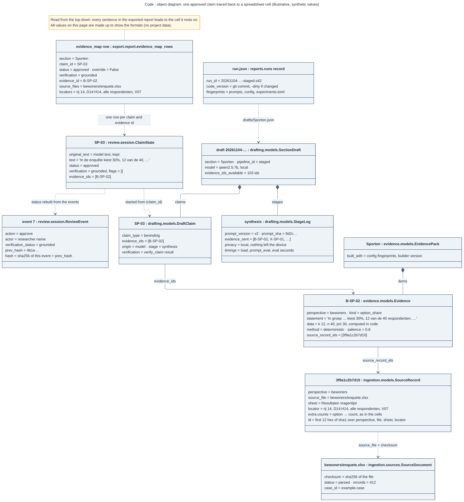](out/46-object-traceability.png)

Full size: [PNG](out/46-object-traceability.png) · [SVG](out/46-object-traceability.svg) · Mermaid source: [46-object-traceability.mmd](src/46-object-traceability.mmd) · [↑ contents](#contents)
