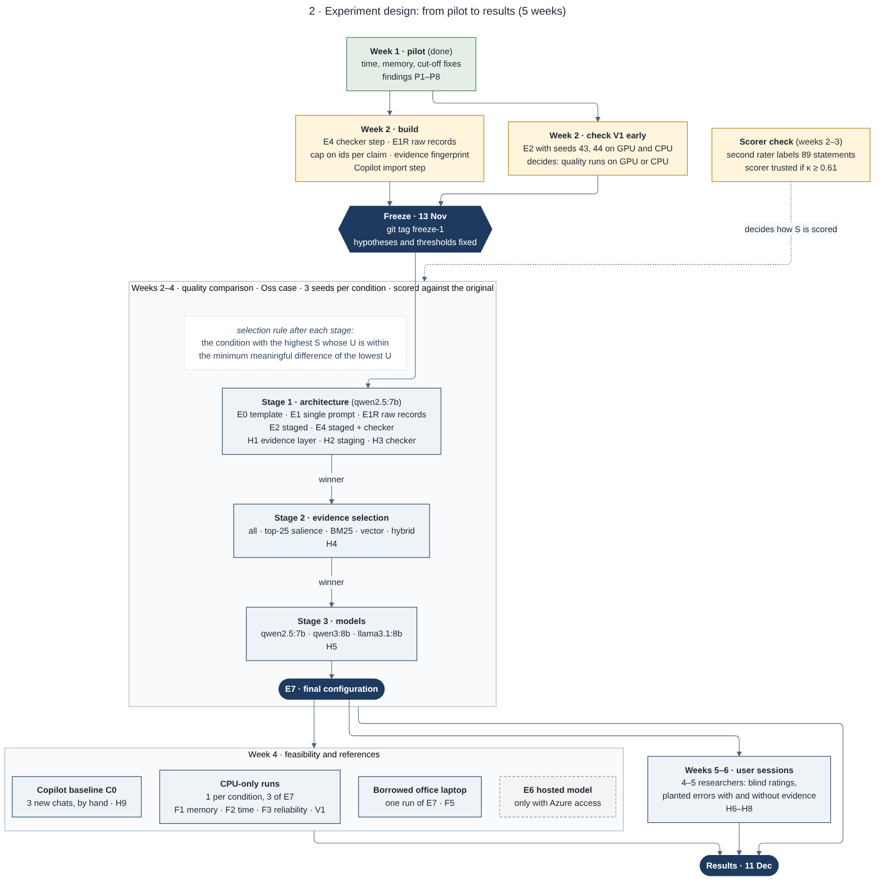
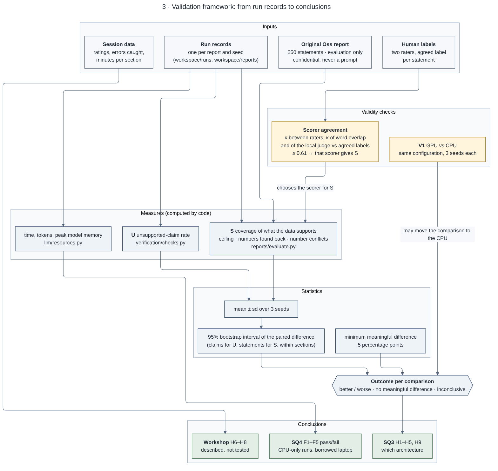

# About this document

This document is the portfolio evidence **Experimental Design and Evaluation Framework**. It
brings together, in one place, how the reporting prototype is evaluated: what is compared, what is
measured, how a difference is judged, which threats to validity are controlled, and how the
framework is built into the code so that every run can be repeated and checked.

It consolidates and explains material that is kept in more detail in the repository:

| Source in the repository | What it holds |
|---|---|
| `docs/experiments/hypotheses-and-thresholds.md` | the pre-registered hypotheses, thresholds and decision rule (git history = what was fixed when) |
| `config/experiments.toml` | the experiment conditions as they run |
| `docs/diagrams/src/02-experiment-design.mmd`, `03-validation-framework.mmd` | the design and validation diagrams (Figures 1 and 2) |
| `src/experiments/`, `src/reports/evaluate.py`, `src/verification/checks.py`, `src/llm/resources.py` | the code that runs and scores the experiments |
| `docs/experiments/week1-pilot.md`, `docs/experiments/first-llm-pilot-experiments.md` | the pilot that tested and sized this framework |

**Status.** The framework is complete and fixed in advance. The pilot (3–4 November) has run on
it; the counted runs start after the freeze (git tag `freeze-1`, planned 13 November 2026).
Points marked **(P)** are proposals still to be confirmed before the freeze.

No research data is in this document. The original Oss report is confidential: it is used as the
evaluation reference only, and nothing is quoted from it.

# 1. What the framework has to answer

The main research question asks for the most efficient, cost-effective and highest-value way to
turn InnoBeweegLab's heterogeneous research data into a *verifiably traceable* draft report, within
a zero budget and on standard office hardware, with the researcher in control. The framework
answers the parts of that question that can be measured:

| Sub-question | What the framework must show | Section |
|---|---|---|
| **SQ3 (Lab)** Which combination of pipeline architecture, evidence selection and model gives the best balance of traceability, factuality, usefulness, speed, compute and cost? | a fair comparison of architectures under identical inputs, with a rule fixed in advance for choosing a winner | 3–6 |
| **SQ4 (Lab)** Does it run on a 16 GB office laptop without a GPU? | pass/fail feasibility thresholds measured on CPU-only runs | 7 |
| **Workshop** Does the review interface help researchers find errors and trust the draft? | a small, descriptive user study with planted errors | 9 |
| **Showroom** How does the result compare with a naive baseline, with current practice and with the human-written report? | three reference points scored with the same measures | 4, 8 |

Answering "which architecture is best" by impression would not survive examination, and the
literature reviewed in the background research shows why: LLM output is stochastic, so a single run
per condition can mistake noise for an effect; automated judges are biased and must be validated
against people; and roughly half of published NLP evaluations do not document their human
evaluation well enough to be repeated. The framework is designed around those three points.

# 2. Design principles

1. **Same input, same output contract.** Every condition reads the same evidence packs for the
   same case and returns the same typed claims (`text`, `type`, `evidence_ids`), so the same
   verifier and scorer apply to all of them. Only the variable under test changes.
2. **Measure, do not judge by eye.** Every measure is computed by code from the run record. A
   human judgement enters only where it is itself measured (inter-rater agreement, Section 8).
3. **Fixed before it is run.** Hypotheses, measures, the decision rule and thresholds are written
   down and committed before any counted run; the set-up is frozen with a git tag. Changes after
   the freeze go into a deviation log with the reason. The winner cannot be picked after seeing
   the results.
4. **Repeated runs.** Three seeds per model condition (42, 43, 44); differences are reported with
   an interval, not as single numbers.
5. **Failures are data.** A failed section is kept and scored as missing. A run is only repeated
   for an infrastructure fault (Ollama crash, power loss, laptop asleep), never because the output
   was poor.
6. **Separate data limits from model limits.** A model must not be blamed for content the data
   cannot support, such as field observations that are in no file. The *ceiling* measure makes
   this explicit.
7. **Confidential data stays local.** The original report and all derived outputs stay in the
   git-ignored workspace; a hosted judge is refused by the code.

# 3. The system under test and the conditions compared

The prototype turns source files into source records (every cell, row and map with a locator),
computes **evidence items** from them in code (every number is computed before a model sees it),
lets a model draft claims that may cite only evidence ids, and checks every claim with a
deterministic verifier. The experiments vary the drafting architecture around that chain.

{width=92%}

## 3.1 Conditions

| Id | Condition | What it tests | State (6 Nov) |
|---|---|---|---|
| **E0** | Template: top-salience evidence written as fixed sentences, 0 model calls | floor for fluency, ceiling for faithfulness | built, run |
| **E1** (A) | Single prompt per section with all evidence of the theme | naive LLM baseline | built, run |
| **E1R** | Same single prompt on the *raw records* (rows and cells as text) instead of computed evidence | whether the evidence layer matters (H1) | to build, week 2 |
| **E2** (B) | Staged: findings per perspective (data, expert, residents), then a synthesis | whether staging helps (H2) | built, run |
| **E3** | Staged with evidence selection: top-25 salience, BM25, vector, hybrid | whether retrieval helps (H4) | top-25 built; others week 3 |
| **E4** | Staged + checker step per claim | whether verification helps (H3) | to build, week 2 |
| **E6** | Best local pipeline with a hosted model (Azure OpenAI in InnoBeweegLab's own EU tenant) | the "hybrid cloud" option of the main question | only if access is given |
| **E7** | Final configuration | feasibility runs and user sessions | after stage 3 |
| **C0** | Microsoft 365 Copilot, used by hand as a researcher would today | current practice (H9) | protocol fixed, week 4 |

E5 (free multi-agent conversation) is deliberately not built: the implementation brief allows a
multi-agent variant only with testable role boundaries, and E2 and E4 already are that
role-separated form (extractor per perspective, synthesiser, checker).

## 3.2 Variables

| Kind | Variable | Values |
|---|---|---|
| Independent (stage 1) | pipeline architecture | E0, E1, E1R, E2, E4 |
| Independent (stage 2) | evidence selection | all, top-25, BM25, vector, hybrid (within the theme) |
| Independent (stage 3) | drafting model | qwen2.5:7b, qwen3:8b, llama3.1:8b (all fit 16 GB at Q4) |
| Controlled | case and sections | `euterpepark-oss`; all sections with evidence; recommendations excluded by design |
| Controlled | prompts | version v2, fingerprinted in every run record |
| Controlled | sampling | temperature 0.2, seeds 42/43/44 |
| Controlled | context window / output limit | 16,384 tokens / 1,800 (3,000 for Conclusies and Aanleiding) |
| Controlled | device | all conditions of one comparison on the same setting (GPU or CPU-only, never mixed) |
| Controlled | start state | cold start: all models unloaded before a run, so load time and memory are the run's own |
| Dependent | traceability, coverage, numbers, time, memory, reliability | Section 4 |

## 3.3 Staged comparison instead of a full factorial

A full factorial (5 pipelines × 5 selections × 3 models × 3 seeds = 225 full reports) does not
fit the time available: on the CPU a full report takes over an hour (pilot). The comparison is
therefore run in three stages, each on the winner of the previous one, with the selection rule
fixed now:

> Among the candidates of a stage, the winner is the condition with the **highest S** whose **U is
> not worse than the lowest U by more than the minimum meaningful difference**. If two candidates
> are within that difference on both measures, the faster one wins.

E1R and C0 are references, never candidates. If the pilot timing had shown a full report takes
more than about three hours, stages 2 and 3 would use three of the six themes **(P)**; it did not.
This design trades the ability to detect interactions (for example, a pipeline that is best only
with one model) for a comparison that can be finished; that trade-off is stated as a limitation.

# 4. Measures

All measures are computed by code from the run record and the evaluation against the original
report.

| Measure | Definition | Code | Role |
|---|---|---|---|
| **U** unsupported-claim rate | claims with no valid citation, or with a number not present in the cited evidence, over all claims | `verification/checks.py` | primary: traceability (NFR1, FR5, FR6) |
| **S** coverage of what the data supports | statements of the original report that the evidence can support *and* the draft covers, over the supportable statements | `reports/evaluate.py` | primary: usefulness against the human report |
| Ceiling | share of the original's 250 statements the evidence can support at all | `reports/evaluate.py` | context: separates data limits from model limits |
| Numbers found back / number conflicts | numbers of the original present in the draft; matched statements whose numbers differ | `reports/evaluate.py` | secondary: factual accuracy |
| Grounded / weak rate, citation validity | verifier labels per claim (weak = e.g. over-generalisation, attribution mismatch, theme mismatch) | `verification/checks.py` | secondary |
| Time per report; load, prompt and output speed | wall-clock time and the model server's own timings | run `totals` | cost (SQ3), feasibility (SQ4) |
| Peak model memory | memory of the Ollama processes sampled every second, plus what Ollama reports per model | `llm/resources.py` | feasibility (NFR5) |
| Failed sections | sections without readable output, with the reason | run `totals` | reliability |
| Monetary cost | EUR per run (local = 0) | provider config | cost (NFR6) |

Why these two primaries: **U** captures the core promise of the system (every claim traceable to
a checkable source), and **S** captures whether the draft is *useful*, measured against the report
InnoBeweegLab actually wrote rather than an abstract quality score. Optimising one alone is easy
and useless (a draft with one safe claim has U = 0; a draft that copies everything has high S and
many unsupported claims), so the selection rule always reads them together.

# 5. Hypotheses

| Id | Stage | Hypothesis | Measure and threshold |
|---|---|---|---|
| **H1** evidence layer | 1 | A single prompt given computed evidence (E1) produces fewer unsupported claims and fewer wrong numbers than the same prompt given raw records (E1R). | U lower by ≥ MMD; fewer number conflicts; more numbers found back |
| **H2** staging | 1 | Staged drafting (E2) covers more of what the data supports than the single prompt (E1), without more unsupported claims. | S higher by ≥ MMD; U not worse by more than MMD |
| **H3** verification | 1 | A checker step (E4) lowers unsupported claims compared with E2 at little cost in coverage. | U lower by ≥ MMD; S not worse by more than MMD; extra time reported |
| **H4** retrieval | 2 | Selecting evidence before drafting lowers U but also lowers S. | judged per variant with the rule of Section 6 |
| **H5** models | 3 | No direction expected between the three models (exploratory). Llama 3.1 does not list Dutch as a supported language; recorded, not tested. | U, S, time, memory with intervals |
| **H9** current practice | ref. | The final configuration is more traceable than Copilot used by hand, at a coverage not lower by more than the MMD. | share of sampled statements without a supporting source, lower by ≥ MMD **(P)**; number conflicts; S |

H6–H8 (user sessions) are in Section 9.

# 6. How a difference is judged

For a comparison X versus Y on the same seeds and sections:

1. The difference in U and in S, pooled over the three seeds.
2. A 95% bootstrap confidence interval for that difference, resampling claims (for U) or the
   original's statements (for S) within each section, 2,000 resamples **(P)**.
3. A **minimum meaningful difference (MMD) of 5 percentage points (P)**: my judgement of the
   smallest change a researcher would notice in a full report. No published standard exists for
   this task, so it is stated openly as a judgement and fixed before the runs.

| Outcome | Rule |
|---|---|
| **Better / worse** | the interval excludes 0 **and** the difference is at least the MMD |
| **No meaningful difference** | the whole interval lies within ± MMD |
| **Inconclusive** | anything else: reported as such, never as a win |

This rule separates *statistical* from *practical* significance and gives "no difference" its own
outcome, which matters for a small organisation: if a cheaper or faster architecture is not
meaningfully worse, that is a useful result. With one case and three seeds these are descriptive
intervals over the statements of one report, not a test that generalises to other
neighbourhoods; the results chapter says so.

# 7. Feasibility thresholds (SQ4, pass/fail)

| Id | Threshold | Basis |
|---|---|---|
| **F1** memory | Peak model memory ≤ 9.6 GB in every CPU-only run of the final configuration | 0.6 × 16 GB (`config/models.toml`, NFR5): the rest is left for the operating system and office programs |
| **F2** time | A full report on CPU only within 8 hours, i.e. overnight **(P)** | NFR5 and Scenario C (drafting runs overnight) |
| **F3** reliability | Every section drafted in all three CPU-only runs of the final configuration **(P)** | – |
| **F4** cost | EUR 0 for local runs | NFR6, zero project budget |
| **F5** target laptop | Descriptive: one run of the final configuration on a borrowed corporate laptop (16 GB, CPU only), recording the memory other programs already used | the end users' real hardware |

**Where quality and where cost are measured.** Quality (U, S) is compared on the Mac's GPU
because CPU-only runs took four to six times longer in the pilot; time and memory count only from CPU-only runs,
because InnoBeweegLab's corporate laptops have no GPU that Ollama can use. This split is only valid
if GPU and CPU differ by chance, which is tested (V1, Section 8).

# 8. Validity checks

| Threat | Control |
|---|---|
| **The automatic scorer for S is wrong.** Word overlap reached κ = 0.38 against 89 developer-labelled statements, only "fair" agreement. | A second rater labels the same statements independently; the raters agree one label per statement. A scorer (word overlap, or the local LLM judge) is used for S only if κ ≥ 0.61 against the agreed labels **(P)** (lower bound of "substantial", Landis & Koch 1977). Otherwise S is reported from the human labels only. |
| **GPU and CPU give systematically different text (V1).** In the pilot, CPU drafts covered more than GPU drafts twice. | V1 runs early (week 2): E2 with seeds 43 and 44 on GPU and CPU. Pass = not "better/worse" by the Section 6 rule and smaller than the MMD. If V1 fails, the quality comparison moves to CPU-only. |
| **Leakage of the reference.** The model sees the human report. | The original PDF is excluded at ingestion (`excluded_reference_report`); it is read only by the evaluator; a hosted judge is refused (`test_hosted_judge_refused`). |
| **Silent truncation.** A prompt longer than the context window is cut without an error. | Found in the pilot (P1). The provider now fails the stage with the reason when a prompt arrives cut, the window fills, or the answer hits the output limit; the section is recorded as failed. |
| **Changing set-up during the comparison.** | Every run record stores the code version (with `-dirty` if uncommitted), fingerprints of prompts and configuration, dataset checksums, machine and device. Counted runs must match the frozen commit. |
| **Cherry-picking runs.** | Failed sections count as missing; repeats only for infrastructure faults, logged in the deviation log. |
| **Unfair baseline.** Copilot is made to look worse than it is. | C0 gets a fixed Dutch prompt that asks for the file, sheet and cell of every fact, the same source files the tool reads, three new chats, and the same scorer plus a manual source check on 30 sampled statements, applied equally to the final configuration. |
| **The measure itself is broken.** | Sanity tests in `tests/test_reports.py`: a report compared with itself scores above 90%, and the ceiling does not depend on the draft (TC21). |

{width=88%}

# 9. Human evaluation (weeks 5–6, descriptive)

Four to five InnoBeweegLab researchers, one session each. With this many people, results are
described, not tested for significance.

| Id | Expectation | Measure |
|---|---|---|
| **H6** verification interface | Reviewers catch more planted errors with the evidence panel than without (NFR3: visible provenance changes reliance but does not always improve accuracy, the "accountability paradox" in the HCI literature). | share of planted errors found and minutes per section, per person and condition; order alternated |
| **H7** usefulness | The final configuration is rated useful for report writing. | median ≥ 4 on a 5-point scale **(P)**, on the brief's rubric (factual correctness, traceability, completeness, usefulness, clarity, appropriateness of interpretation, correction effort, trust), blind to configuration where feasible |
| **H8** time saved | Researchers estimate that working from the draft saves at least 25% of their writing time **(P)**. | self-estimate; anchored on the stakeholder survey (3 of 5 wanted 25–50%, 2 of 5 wanted 10–25%) |

# 10. How the framework is implemented

The framework is software, not a spreadsheet: every condition runs through the same code path and
leaves a complete, machine-readable record.

```
python -m experiments.cli run E2 --case euterpepark-oss --seed 42 \
       --cold [--cpu-only] --tag pilot-week1b
python -m experiments.cli summary --tag pilot-week1b   # --counted: untagged only
```

| Component | Responsibility |
|---|---|
| `config/experiments.toml` | declarative conditions: pipeline, selection, model, prompt version, seeds, unit (`report` or `section`) |
| `experiments/runner.py`, `experiments/provenance.py` | runs every case × seed, records code version, fingerprints, dataset checksums, machine, device |
| `reports/runs.py` | drafts every section of a full report with one model, verifies it, renders the Word report |
| `llm/providers.py` | Ollama and OpenAI-compatible adapters behind one interface (NFR8); preflight check; truncation detection |
| `llm/resources.py` | samples model-server and machine memory every second; compares the peak with 0.6 × 16 GB |
| `verification/checks.py` | deterministic per-claim checks (citation, number, perspective, over-generalisation, norm, theme, style) → U |
| `reports/evaluate.py`, `reports/judge.py` | comparison with the original: structure, coverage, ceiling, S, numbers; optional local judge; `alignment.csv` for human labels and κ |
| `scripts/pilot_summary.py` | aggregates run records into a numbers-only table and charts for the documentation |
| `tests/` (107 tests, synthetic data) | includes TC19–TC21: unreachable model refused before the run, hosted judge refused, scorer sanity |

Each run writes `workspace/runs/<run_id>.json` (git-ignored, because drafts contain research
data). The documentation reports only aggregate numbers taken from those records.

# 11. Planning

| Week | Activity |
|---|---|
| 1 (3–6 Nov) | pilot on the framework (done, see *First LLM Pilot Experiments*) |
| 2 (9–13 Nov) | build E4 and E1R; fixes from the pilot; V1 early; second rater starts; **freeze 13 Nov** |
| 2–4 | stage 1 (architecture), stage 2 (selection), stage 3 (models) on the GPU, three seeds |
| 4 | CPU-only feasibility runs (F1–F3), borrowed laptop (F5), Copilot C0, E6 if access is given |
| 5–6 (7–18 Dec) | user sessions with InnoBeweegLab researchers (H6–H8) |
| January | analysis and reporting |

# 12. Limitations stated in advance

- One case has a human-written report; the results describe that case.
- The pipeline is chosen with one model; the best pipeline may differ per model (staged design).
- Until the second rater has labelled, S rests on the developer's own labels.
- Quality is compared on the Mac's GPU, not on the end users' laptops; V1 tests whether that
  matters.
- The Mac's CPU has faster memory than a typical corporate laptop, so its CPU-only times are a
  best case; only the borrowed-laptop run (F5) shows real times.
- On a corporate 16 GB laptop, other programs often use half the memory; the tool is expected to
  run with them closed, e.g. overnight.
- Copilot's model can change without notice; C0 describes Copilot as used on those dates.

# 13. Traceability of the framework

| Framework element | Traces to |
|---|---|
| U as primary measure | NFR1, FR5, FR6; literature: citation presence alone is not grounding (ALCE, AttributionBench) |
| S, ceiling, comparison with the original | Project Plan §10.1 (evaluate against a human-written reference and a naive baseline); D23–D25 |
| three seeds, intervals | "Do Repetitions Matter?" (arXiv:2509.24086); Biderman et al. |
| scorer validated by κ | Judge's Verdict; Zheng et al. (MT-Bench) on judge biases |
| fixed in advance, deviation log | Mei et al. and van der Lee et al. on documenting evaluation |
| F1–F5 | NFR5, NFR6, SQ4; brief §6 (do not present Mac results as office-laptop proof) |
| C0, E6 | main research question (local vs. hybrid cloud); InnoBeweegLab already uses Microsoft 365 Copilot |
| H6 | NFR3 and the HCI literature on verification interfaces |
| H8 | stakeholder survey in the background research report |

# Version history

| Date | Version | Change |
|---|---|---|
| 2026-11-03 | draft | `hypotheses-and-thresholds.md` written before any counted run |
| 2026-11-04 | draft | where the experiments run (GPU for quality, CPU for cost); Copilot baseline C0 |
| 2026-11-06 | 1.0 | this consolidated evidence document: variables, staged design rationale, validity table, implementation and traceability added |
