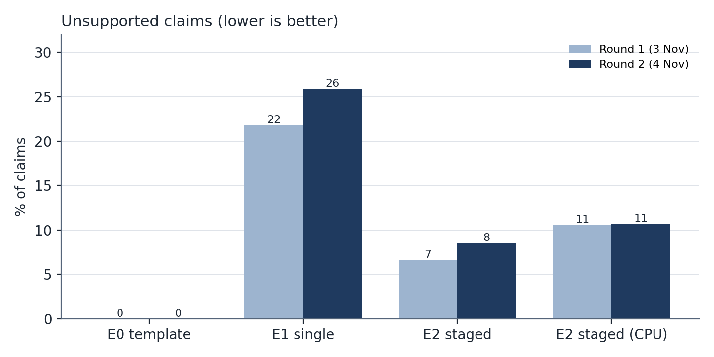
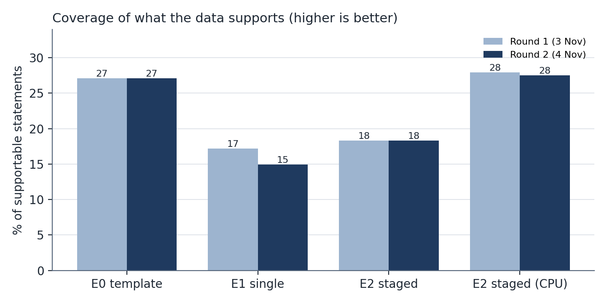
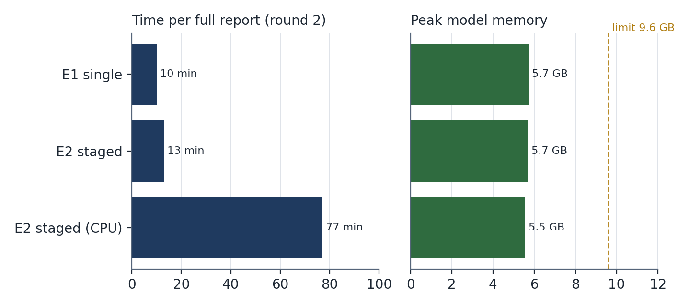

# About this document

This document is the portfolio evidence **First LLM Pilot Experiments**. It reports the first
runs of real local language models through the complete prototype (from InnoBeweegLab's source
files to a scored Word report) on 3 and 4 November 2026, what they showed, and what I changed in
the software and in the experiment plan because of them.

The pilot is not the comparison itself. Its purpose was to test the experiment set-up described
in *Experimental Design and Evaluation Framework* before the freeze, and to size the plan: does a
full report fit in memory, how long does it take, do the measures work, and does anything break
that would make the comparison unfair. Pilot runs carry a tag (`pilot-week1`, `pilot-week1b`,
`smoke-models`) and do not count as results.

| Source in the repository | What it holds |
|---|---|
| `docs/experiments/week1-pilot.md` | the working log of the pilot, findings P1–P8 |
| `docs/experiments/pilot-runs-summary.csv` | numbers of all ten pilot runs, generated from the run records |
| `scripts/pilot_summary.py` | the script that produces that table and the charts in this document |
| `scripts/week1_timing.sh` | the script that ran rounds 1 and 2 |
| `docs/design/reporting-tool-design.md` §13 | design decisions D27–D36 that followed |

Only numbers are reported. Nothing is quoted from the drafts, the source data or the original
report, which is confidential.

# 1. Questions the pilot had to answer

1. **Does it run?** Can a 7–8B model draft every section of a full Oss report through the real
   pipeline, with the verifier, the Word export and the scoring against the original?
2. **Does it fit?** Is peak model memory under the 9.6 GB limit (60% of 16 GB) on the GPU and on
   the CPU only?
3. **How long does it take?** What does one full report cost in time, and so how many runs can
   the comparison afford?
4. **Do the measures behave?** Do U (unsupported claims) and S (coverage of what the data
   supports) produce sensible values, and do they separate the conditions?
5. **What breaks?** Anything that would silently damage a condition and make the comparison
   unfair.

# 2. Set-up

| | |
|---|---|
| Machine | MacBook Pro, Apple M1 Pro, 16 GB RAM (the same memory as the target office laptop) |
| Model server | Ollama on the same machine (`localhost:11434`); nothing sent over the internet; cost EUR 0 |
| Models | qwen2.5:7b (rounds 1 and 2); qwen3:8b and llama3.1:8b (model smoke test) |
| Prompts and sampling | prompt version v2, temperature 0.2, seed 42 (smoke test: seeds 42–44) |
| Case | `euterpepark-oss`: InnoBeweegLab's real Wijkscan data for Oss, re-imported on 3 Nov with the current code; maps measured in code |
| Conditions | E0 template (no model), E1 single prompt per section, E2 staged (findings per perspective, then synthesis), E2 on CPU only |
| Scoring | against the original report: 250 statements; recommendations excluded by design |
| Start state | every model run starts cold: Ollama unloads all models first, so load time and memory are the run's own |
| Measurement | memory of the Ollama processes sampled every second (`llm/resources.py`); the model server's own timings; code version and fingerprints in every run record |

Three rounds were run:

| Round | Date | Code | Context window | Output limit | Runs |
|---|---|---|---|---|---|
| 1 (`pilot-week1`) | 3 Nov | `caabbdd` | 8,192 tokens | 1,800 tokens | E0, E1, E2 GPU, E2 CPU |
| 2 (`pilot-week1b`) | 4 Nov | `c9417ac` + fixes from round 1 | 16,384 tokens | 1,800; 3,000 for Conclusies and Aanleiding | E0, E1, E2 GPU, E2 CPU |
| M (`smoke-models`) | 4 Nov evening | `09ea99a` | 16,384 tokens | as round 2 | E2, Sporten section only, qwen3:8b and llama3.1:8b, 3 seeds each |

# 3. Results

## 3.1 Full reports with qwen2.5:7b

| Round 2 (4 Nov, with the fixes) | E0 template | E1 single prompt (GPU) | E2 staged (GPU) | E2 staged (CPU only) |
|---|---|---|---|---|
| Time for the full report | < 1 s | **10.0 min** | **12.9 min** | **77.0 min** |
| Model calls | 0 | 8 | 26 | 26 |
| Tokens in / out | – | 66,515 / 6,350 | 89,899 / 10,361 | 89,967 / 14,041 |
| Peak model memory | – | 5.7 GB | 5.7 GB | 5.5 GB (0 GB on the GPU) |
| Claims | 72 | 54 | 82 | 75 |
| **U** unsupported claims | 0% | **26%** | **8.5%** | 11% |
| Grounded claims | 100% | 61% | 76% | 77% |
| **S** coverage of what the data supports | **27%** | 15% | 18% | 28% |
| Ceiling (statements the data can support at all) | 52% | 52% | 52% | 52% |
| Numbers of the original found back | 33 of 73 | 14 of 73 | 17 of 73 | 24 of 73 |
| Failed sections | none | none | none | Ontmoeten, Conclusies (P7) |

Round 1 gave the same picture (E1 22% and E2 7% unsupported on the GPU; E2 CPU 11%), but E1's
round-1 scores are not valid because its prompts were cut off (finding P1).

{width=82%}

{width=82%}

{width=88%}

## 3.2 Model smoke test (qwen3:8b and llama3.1:8b)

Before the model comparison (stage 3) can run, the other two candidate models had to be shown to
work through the same pipeline. One section (Sporten), E2, three seeds each, on the GPU:

| One section, E2, mean of 3 seeds | qwen3:8b | llama3.1:8b |
|---|---|---|
| Time per section | 98 s | 112 s |
| Output speed | 20.9 tokens/s | 19.8 tokens/s |
| Peak model memory | 7.6 GB | 7.1 GB |
| Claims (min–max) | 16 (15–16) | 23 (12–37) |
| Unsupported claims | 0% | 3% (0–10%) |
| Failed sections | none | none |

Both models run, stay under 9.6 GB with the 16K window, and produce verifiable claims. They need
1.4–1.9 GB more than qwen2.5:7b: larger weights and a larger KV cache for the 16K window, still
2–2.5 GB below the limit.
llama3.1:8b varies far more between seeds (12 to 37 claims for the same section), an early sign
that three seeds per condition are the minimum, not a luxury.

## 3.3 How to read these numbers

Each cell of Section 3.1 is **one run with one seed**. By the decision rule of the framework,
none of these differences is a result yet. Two things point the same way in both rounds, as a
signal for the plan, not as evidence:

- the staged pipeline E2 has far fewer unsupported claims than the single prompt E1 (7–8.5%
  against 22–26%), also after E1 got its full prompts;
- every model draft covers less of what the data supports than the deterministic template (15–18%
  against 27% on the GPU), while the template cannot write synthesis or conclusions. The value of
  a model has to come from what the template cannot do, at an acceptable U.

The ceiling of 52% shows that almost half of the human report's statements cannot be supported by
the source files at all (field observations, the residents' meeting, team knowledge). That is a
property of the data, not of any model, and is why S is measured against the supportable part.

# 4. Findings

## P1. Prompts longer than the context window were cut off without any error

In round 1, four single-prompt calls arrived at Ollama as exactly 4,098 tokens, while their text
(26,000–33,000 characters) needed about 10,000–12,000. Normal prompts took 2.0–2.9 characters per
token; these took 6.5–8.2. When a prompt is longer than the window, Ollama keeps the first few
tokens and the last half of the window and drops the rest, **without an error**. A fifth call
filled the window while writing. So 5 of E1's 8 calls worked from a partial prompt, with
instructions and evidence missing. Without detecting this, the E1-versus-E2 comparison (H2) would
have compared a damaged E1 with E2.

**Change:** the provider now detects a cut prompt (more than 4.5 characters per token), a window
that fills while writing, and an answer that hits the output limit, and fails the stage with the
reason. The section is recorded as failed, never dropped (D31). The window was raised to 16,384
tokens (D32). Round 2: no prompt was cut off; the largest was 12,404 tokens.

## P2. The conclusions did not fit the output limit

Conclusies failed in E1 and E2 in round 1: the JSON answer was cut at 1,800 tokens. **Change:**
3,000 tokens for Conclusies and Aanleiding. Round 2: drafted on the GPU in both (681 output
tokens in E2).

## P3. Memory is well within the limit, but the laptop is not empty

Peak model memory was 5.1–5.7 GB in all qwen2.5:7b runs; the 16K window added 0.3–0.5 GB, as
estimated. The whole Mac, however, already had 10.4–14.4 GB in use before the runs (other apps
open). On a 16 GB office laptop the model fits, but only with few other programs open. This moved
into the feasibility plan: F5 (a run on a borrowed corporate laptop) now records what memory other
programs already use.

## P4. One to one and a quarter hours per report on the CPU

| | GPU (Apple M1 Pro) | CPU only, round 1 | CPU only, round 2 |
|---|---|---|---|
| Reading the prompt | 220–300 tokens/s | 72 tokens/s | 58 tokens/s |
| Writing the answer | 21–24 tokens/s | 7.1 tokens/s | 4.6 tokens/s |
| Full E2 report | 12.9–14.5 min | 58.6 min | 77.0 min |

The 8-hour threshold (F2, overnight) is far away even on a slower office CPU. But the comparison
cannot run on the CPU in reasonable time: about 30 reports would take five to six nights instead
of two or three evenings on the GPU. **Change:** quality is compared on the GPU; time and memory
count only from CPU-only runs (D33).

## P5. GPU and CPU give different reports, twice in the same direction

E2 with identical prompts, settings and seed: on the CPU it covered more (28% against 18%) and
found more numbers (24 against 17) than on the GPU, in both rounds. Some difference is expected
(different floating-point order changes the first word, and then everything after it), but the
same direction twice may be systematic. Because the decision to compare quality on the GPU depends
on this, **validity check V1** (three seeds on each device) was moved to the start of week 2,
before the freeze.

## P6. Retries for broken JSON

Two of 26 calls in the round-1 CPU run returned unreadable JSON at the end of long answers and were
retried once (2–5 minutes each on the CPU). None in round 2.

## P7. On the CPU the model sometimes numbers invented evidence ids until the output limit

In the round-2 CPU run, two answers became lists of non-existent evidence ids counted one after
another until the limit. The new truncation check (P1) caught both and failed the sections
visibly instead of passing broken output on. **Change, before the freeze:** cap the number of
evidence ids per claim in the answer format and the prompt.

## P8. Editing files during a run marks it "-dirty"

Two round-2 runs record code version `c9417ac-dirty` because documentation was edited while they
ran. **Change, before the freeze:** only code, prompts and configuration count as dirty.

# 5. What the pilot changed

| Area | Before the pilot | After the pilot |
|---|---|---|
| Model calls | a cut prompt or answer passed silently | fails the stage with the reason; section recorded as failed (D31) |
| Context and output | 8K window; 1,800 output tokens everywhere | 16K window; 3,000 for Conclusies and Aanleiding (D32) |
| Measurement | Python's own memory | model-server memory every second, model timings, cold starts, CPU-only switch (D29, D30) |
| Where runs happen | not decided | quality on GPU, time and memory on CPU only, V1 first (D33) |
| Run budget | unknown | ~10/13 min per report on GPU, ~50/77 min on CPU; ~30 reports in two to three GPU evenings |
| Feasibility | memory of the model only | also the memory other programs use (F5) |
| Before the freeze | – | cap on evidence ids (P7), dirty rule (P8), V1 early |

The single most important result is P1. It is the kind of fault that does not show up in tests
with a fake model, produces plausible-looking output, and would have biased the central comparison
against the simplest architecture. Running the real pipeline on the real case before freezing the
plan is what found it.

# 6. Answers to the pilot questions

| Question | Answer |
|---|---|
| Does it run? | Yes. All three candidate models drafted through the full pipeline; qwen2.5:7b produced complete scored Word reports for E1 and E2. |
| Does it fit? | Yes. 5.5–5.7 GB (qwen2.5:7b) and 7.1–7.6 GB (qwen3:8b, llama3.1:8b) peak model memory, under 9.6 GB, on GPU and CPU. |
| How long? | 10–13 min per report on the GPU, 1–1¼ h on the M1 Pro CPU; well within an overnight run. |
| Do the measures behave? | U separates E1 and E2 clearly; S and the ceiling behave as designed; the scorer still needs its κ check (Framework, Section 8). |
| What breaks? | Silent prompt truncation (P1), output limit (P2), id-numbering loops on the CPU (P7): all now detected or fixed. |

# 7. Limitations

- One seed per condition in rounds 1 and 2; one section in the model smoke test.
- One case, on a Mac; the CPU-only times are a best case for an office laptop.
- S rests on a word-overlap scorer with κ = 0.38 against my own labels; it is used here only to
  check that the measure works, not to compare conditions.
- E1R, E3 (beyond top-25) and E4 were not yet built and are not in the pilot.

# 8. Next steps (week 2, before the freeze on 13 November)

1. Cap evidence ids per claim (P7); count only code, prompts and configuration as dirty (P8).
2. Run V1: E2 with seeds 43 and 44 on the GPU and on the CPU only.
3. Build E4 (checker step) and E1R (raw records); decide whether E4 only flags or revises once.
4. Second rater labels the 89 statements for the scorer check.
5. Freeze with git tag `freeze-1`, then start stage 1.

# Version history

| Date | Version | Change |
|---|---|---|
| 2026-11-03 | log | round 1 run and findings P1–P6 (`week1-pilot.md`) |
| 2026-11-04 | log | round 2 with fixes, P7–P8, run budget; model smoke test in the evening |
| 2026-11-06 | 1.0 | this evidence document: results of all three rounds including the model smoke test, charts and table generated from the run records by `scripts/pilot_summary.py`, what the pilot changed |
